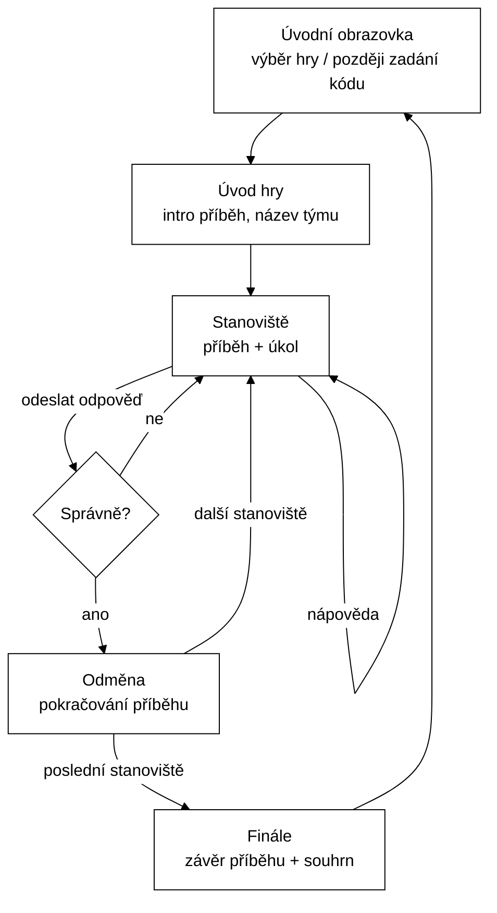

# 01 — Analýza

## 1. Koncept

Zážitkový Loket je mobilní webová aplikace pro příběhové hry v exteriéru i interiéru hradů a v přilehlých městech. Hra kombinuje prvky gamebooku (příběh, který se odvíjí s postupem) a únikovky (úkoly a hádanky, jejichž vyřešení odemyká další část příběhu).

Příklad budoucí hry: příběh loketského kata, kdy hráč prochází hradem a městem pod ním a hledá indicie — třeba letopočet na fasádě domu, nápis na erbu nebo počet oken věže.

### Obchodní model (výhled, mimo prototyp)

- Přístupový kód se prodává na pokladně hradu (fyzicky, např. vytištěný na lístku).
- Výnos se dělí mezi provozovatele aplikace a správu hradu — poměr bude dohodnut individuálně s každým partnerem.
- Postupně přibývají další hrady a zámky; každý partner může mít jednu či více her.

### Proč webová aplikace (PWA), ne nativní

- Hráč nic neinstaluje — naskenuje QR z lístku nebo otevře adresu a zadá kód.
- Jeden kód pro všechny platformy, rychlé nasazování změn obsahu i mechanik.
- Později lze doplnit PWA (ikona na ploše, offline cache).

## 2. Aktéři

| Aktér | Popis | Prototyp |
|---|---|---|
| **Hráč** | Návštěvník hradu (jednotlivec, rodina, skupina sdílející jeden telefon). Anonymní, bez účtu. | ✅ |
| **Pokladní** | Vydává kartičky s kódy na pokladně hradu (v aplikaci nic neeviduje — prodej = aktivace kódu hráčem). | — |
| **Partner** | Správa hradu — smluvní strana, podíl na výnosech, kontrola počtu aktivovaných kódů v měsíci kvůli fakturaci. | ✅ vlastní přihlášení do administrace (role `PARTNER`) |
| **Autor hry / Admin** | Tvoří a ladí obsah her, generuje dávky kódů, sleduje statistiky. | ❌ (obsah přes seed) |

## 3. Případy užití

### Prototyp

| ID | Případ užití | Popis |
|---|---|---|
| UC-01 | Výběr hry (demo) | Hráč na úvodní obrazovce vidí publikované hry a spustí jednu bez kódu. |
| UC-02 | Zahájení hry | Vytvoří se herní relace, hráč dostane token (uložený v prohlížeči) a uvidí úvodní příběh. Volitelně zadá název týmu. |
| UC-03 | Zobrazení stanoviště | Hráč vidí příběh stanoviště, zadání úkolu a vstup pro odpověď. |
| UC-04 | Odeslání odpovědi | Server odpověď normalizuje a porovná s přijímanými variantami. Správně → odměna a odemčení dalšího stanoviště. Špatně → zpráva a možnost zkusit znovu. |
| UC-05 | Nápověda | Hráč si vyžádá další nápovědu v pořadí; za každou se připočte časová penalizace. |
| UC-06 | Finále | Po posledním stanovišti se zobrazí závěrečný příběh a souhrn (čas, počet nápověd, penalizace). |
| UC-07 | Obnovení hry | Po zavření a znovuotevření prohlížeče pokračuje hráč tam, kde skončil (token v `localStorage`). |
| UC-08 | Ukončení / nová hra | Hráč může rozehranou hru opustit a začít znovu. |

### Výhled (mimo prototyp)

| ID | Případ užití |
|---|---|
| UC-10 | Spuštění hry zadáním přístupového kódu (validace, aktivace, platnost) — ✅ hotovo |
| UC-11 | Generování dávky kódů pro partnera a hru (export pro tisk) — ✅ hotovo (administrace, CSV) |
| UC-12 | Administrace obsahu hry (stanoviště, odpovědi, nápovědy, obrázky) |
| UC-13 | Statistiky obtížnosti — na kterých stanovištích hráči nejvíc chybují, kolik nápověd berou |
| UC-14 | Přehled pro partnera — aktivované kódy po měsících, podíl na výnosech — ✅ hotovo (přehled správce i vlastní přístup hradu) |
| UC-15 | Ověření polohy (GPS) nebo QR kód na stanovišti |
| UC-16 | Offline režim |
| UC-17 | Jazykové mutace her (EN, DE) |

## 4. Herní mechanika (prototyp)

Mechanika se bude během vývoje vymýšlet a zdokonalovat, prototyp proto stojí na nejjednodušším základu, který jde snadno rozšířit.

- **Lineární průchod:** stanoviště jdou v pevném pořadí (`order_no`). Další se odemkne po vyřešení předchozího.
- **Typy úkolů:**
  - `TEXT` — volná textová odpověď (slovo, jméno)
  - `NUMBER` — číselná odpověď (letopočet, počet)
  - `CHOICE` — výběr z nabídnutých možností
- **Více přijímaných odpovědí:** jedno stanoviště může mít několik správných variant (např. „jáma“, „díra“).
- **Normalizace odpovědi** (stejná pro zadání i uložené varianty): oříznout mezery, malá písmena, odstranit diakritiku, sloučit vícenásobné mezery, odstranit interpunkci. U `NUMBER` ponechat jen číslice.
- **Nápovědy:** každé stanoviště má 0–N nápověd v pořadí, každá s vlastní penalizací v sekundách. Hráč je odkrývá postupně.
- **Odměna:** po vyřešení se zobrazí `reward_text` (pokračování příběhu, případně indicie pro finále — např. písmeno tajenky).
- **Hodnocení:** celkový čas = (konec − začátek) + součet penalizací. V prototypu jen informativně, bez žebříčku.
- **Platnost relace:** relace vyprší po `game.session_validity_hours` (výchozí 24 h).

### Navržená rozšíření mechaniky (pro budoucí ladění)

Datový model je připraven tak, aby šla přidávat bez přestavby jádra: přeskočení stanoviště (`SKIPPED`), větvení příběhu, nové typy úkolů (foto, GPS, QR, poskládání obrázku), časový limit, omezení počtu pokusů, týmové soutěžení.

## 5. Herní flow (obrazovky)

### Popis obrazovek

1. **Úvodní obrazovka** — název aplikace, seznam publikovaných her (v prototypu). Pokud existuje rozehraná relace, nabídne „Pokračovat ve hře“.
2. **Úvod hry** — název, podtitul, odhadovaná délka, úvodní příběh, pole „Název týmu“ (nepovinné), tlačítko „Začít“.
3. **Stanoviště** — ukazatel postupu (např. 2 / 5), nadpis, příběh, zadání úkolu, vstup podle typu (text / číslo / výběr), tlačítko „Odeslat“, tlačítko „Nápověda“ a seznam již odkrytých nápověd.
4. **Odměna** — potvrzení úspěchu, `reward_text`, tlačítko „Pokračovat“.
5. **Finále** — závěrečný příběh, souhrn (celkový čas, nápovědy, penalizace), tlačítko „Zpět na začátek“.

### UX požadavky

- Mobile-first, ovladatelné jednou rukou, velká tlačítka, čitelné písmo i na slunci (vysoký kontrast).
- Rychlé načítání i na slabém mobilním signálu (malý bundle, žádné těžké knihovny).
- Žádná registrace, žádné osobní údaje.

## 6. Nefunkční požadavky

| Oblast | Požadavek |
|---|---|
| Výkon | Odezva API < 300 ms; očekávaná zátěž desítky současných hráčů na lokalitu |
| Bezpečnost | Správné odpovědi nikdy na klientovi; token relace jako neuhodnutelné UUID; budoucí kódy z kryptograficky bezpečného generátoru |
| Soukromí | Žádné osobní údaje; název týmu je nepovinný volný text |
| Dostupnost | Prototyp lokálně; ostrý provoz s ohledem na sezónu (víkendy, prázdniny) |
| Rozšiřitelnost | Více partnerů, lokalit a her bez změny schématu |
| Analytika | Ukládat všechny pokusy o odpověď — slouží k ladění obtížnosti úkolů |

## 7. Otevřené otázky

| # | Otázka | Stav |
|---|---|---|
| Q1 | Hosting ostrého provozu (VPS s Dockerem, cloud, SAP BTP?) | otevřeno |
| Q2 | Formát a délka přístupového kódu, tisk na lístek, QR s předvyplněným kódem | rozhodnuto: 8 znaků bez 0/O/1/I/L, tisk `ABCD-2345`; kartičky z CSV (sloupec s odkazem `?kod=` pro QR); generování v administraci |
| Q3 | Platnost kódu (jen den nákupu? 24 h od aktivace?) | rozhodnuto: 5 h od aktivace (= prvního spuštění hry), nastavitelné na dávce; hra končí nejpozději s kódem. Opakované zadání kódu pokračuje ve stejné hře (i na jiném telefonu). Prodej = aktivace, stav `SOLD` se nepoužívá. Demo hra jen pro vývoj přes kód `DEMO-KATA` bez expirace. |
| Q4 | Offline režim — nutný? (signál v hradbách) Pokud ano, jak řešit ověření odpovědí (hashe na klientovi) | otevřeno |
| Q5 | Jazykové mutace — samostatné hry na jazyk, nebo překladové tabulky | otevřeno |
| Q6 | Podíl na výnosech a vyúčtování s partnery | částečně: podíl se nastavuje u hradu v administraci a při generování se zafixuje na dávce kódů (změna nepřepíše vyfakturované měsíce); měsíční přehled ukazuje tržbu a podíl. Otevřené: samotné fakturační doklady, DPH |
| Q7 | Jak ověřovat, že je hráč skutečně na místě (GPS, QR, nic) | otevřeno |
| Q8 | Kdy se plní `accepted_answer.normalized_value`? | rozhodnuto (M2): v seedu ručně + test shody s `TextNormalizer`; budoucí admin dopočítá při zápisu |
| Q9 | Opakované spuštění seedu (`R__demo_game.sql`) smaže i rozehrané relace demo hry | akceptováno pro dev profil |
| Q10 | Jak dostat build frontendu do JAR (frontend-maven-plugin vs. krok v buildu) | rozhodnuto (M5): `pom.xml` bere `../frontend/dist` jako resource, Docker build ve dvou fázích; Maven nepotřebuje Node |
| Q11 | Rate limiting odpovědí (ochrana proti hrubé síle u `NUMBER`) | otevřeno — ověřování kódů a přihlášení do administrace limit má (na IP), odpovědi na úkoly zatím ne; nutné před ostrým provozem |
| Q12 | Administrace pro partnera (hrad): vlastní přihlášení, vidí jen svá data — měsíční počty aktivovaných kódů pro kontrolu fakturace | rozhodnuto a hotovo: jedno přihlášení na `/admin`, role `ADMIN` (správce aplikace, účet z konfigurace) a `PARTNER` (účty hradů v tabulce `partner_user`, zakládá je správce). Hrad vidí měsíční aktivace s tržbou a svým podílem a své dávky kódů (bez CSV a vývojových kódů), může si změnit heslo. |
