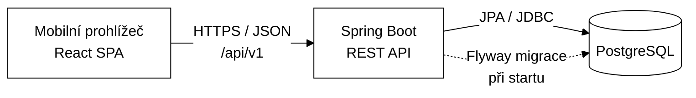

# 02 — Architektura

## 1. Přehled

Klasická třívrstvá webová aplikace: React SPA (mobilní prohlížeč) → REST API ve Spring Bootu → PostgreSQL. Stejný stack v prototypu i v ostrém provozu.



### Klíčová rozhodnutí

| Rozhodnutí | Volba | Důvod |
|---|---|---|
| Typ klienta | SPA (React), později PWA | Bez instalace, jeden kód pro všechny telefony |
| Komunikace | REST + JSON, verze `/api/v1` | Jednoduché, dobře testovatelné |
| Stav hry | Na serveru (tabulka `game_session` + `session_progress`) | Odpovědi se ověřují na serveru, hra přežije zavření prohlížeče, data pro analytiku |
| Identita hráče | Anonymní token relace (UUID v4) v `localStorage` + hlavička `X-Session-Token` | Žádné účty, žádné osobní údaje |
| Obsah her | V DB, v prototypu nahraný Flyway seed migrací | Připraveno na budoucí administraci |
| Schéma DB | Flyway, `ddl-auto=validate` | Kontrolované změny schématu |
| Nasazení | Jeden Spring Boot JAR, který servíruje i build frontendu (`static/`) | Jedna jednotka nasazení, žádné CORS v produkci |

## 2. Backend

### Technologie

- Java 21 LTS, Spring Boot 4.1 (Hibernate 7, Jackson 3), Maven Wrapper
- Starters: `webmvc`, `data-jpa`, `validation`, `actuator`, `flyway` (ve Spring Boot 4 má Flyway vlastní starter) + `flyway-database-postgresql`, `postgresql` driver
- Testy: `spring-boot-starter-*-test` (např. `webmvc-test`, `data-jpa-test`), `spring-boot-testcontainers`, Testcontainers (`testcontainers-postgresql`, `testcontainers-junit-jupiter`)
- Lombok **nepoužívat** — DTO jsou `record`, entity s ručními gettery/settery.

### Balíčky (package-by-feature)

```
cz.mibcon.zazitky            # (název balíčku lze upravit)
├── ZazitkyApplication.java
├── common/                  # ApiExceptionHandler (ProblemDetail), ApiException + NotFound/InvalidState,
│                            # TextNormalizer, ClockConfig (Clock bean), SpaWebConfig (frontend + SPA fallback)
├── game/                    # čtení obsahu
│   ├── domain/              # Partner, Location, Game, Station, Hint, AcceptedAnswer, StationChoice + enumy
│   ├── *Repository.java     # jedno repository na tabulku
│   ├── GameService.java
│   ├── GameController.java  # /api/v1/games
│   └── GameSummaryDto, GameDetailDto
├── session/                 # herní logika
│   ├── domain/              # GameSession, SessionProgress, AnswerAttempt + enumy
│   ├── SessionService.java
│   ├── AnswerEvaluator.java # normalizace + porovnání odpovědí
│   ├── SessionController.java # /api/v1/sessions
│   ├── SessionDtos.java     # request/response recordy
│   └── InvalidTokenException (401), SessionExpiredException (410)
└── accesscode/              # v prototypu jen entity + repo
    └── domain/              # AccessCodeBatch, AccessCode
```

### Vrstvy uvnitř feature

`Controller` (HTTP, validace vstupu, mapování na DTO) → `Service` (transakce, herní pravidla) → `Repository` (Spring Data JPA). Controllery neobsahují logiku, entity neopouštějí service vrstvu.

### Herní logika (`SessionService`)

1. **start(gameId, teamName)** — ověří, že hra je `PUBLISHED`; vytvoří `game_session` se stavem `IN_PROGRESS`, `token = UUID.randomUUID()`, `expires_at = now + session_validity_hours`; vytvoří `session_progress` pro první stanoviště se stavem `ACTIVE`.
2. **getState(token)** — vrátí aktuální stav; pokud je relace `IN_PROGRESS` a `expires_at <= now`, nastaví `EXPIRED` a vrátí 410 (změna stavu se uloží, `noRollbackFor`).
3. **submitAnswer(token, stationId, answer)** — v transakci:
   - stanoviště musí být aktuálně `ACTIVE` v dané relaci (jinak 409);
   - zapíše `answer_attempt` (každý vyhodnocený pokus, i špatný; požadavek odmítnutý 401/404/409/410 se nezapisuje);
   - `AnswerEvaluator` normalizuje vstup a porovná s `accepted_answer.normalized_value`;
   - při úspěchu: progress → `SOLVED`, `solved_at`; další stanoviště → `ACTIVE`; pokud žádné není, relace → `COMPLETED`, `finished_at`.
4. **revealHint(token, stationId)** — zvýší `hints_used` (max. počet nápověd stanoviště) a připočte penalizaci do `penalty_seconds` relace; vrátí odkryté nápovědy.

5. **abandon(token)** — `IN_PROGRESS` → `ABANDONED`; opakované volání je bez efektu, u `COMPLETED` 409.

Časy se berou z beanu `Clock` (testovatelnost). Souběh: dvojité odeslání z jednoho telefonu ošetřuje optimistické zamykání — `@Version` na `game_session` a načítání relace s `OPTIMISTIC_FORCE_INCREMENT` u všech zápisových operací.

### Normalizace odpovědí (`TextNormalizer` v `common`)

```
trim → toLowerCase(Locale.ROOT) → Normalizer.Form.NFD + odstranit \p{M} (diakritika)
     → odstranit interpunkci [^\p{L}\p{N} ] → sloučit mezery
NUMBER: navíc odstranit vše kromě číslic
```

Normalizovaná hodnota se ukládá do `accepted_answer.normalized_value`. **Rozhodnuto v M2:** v seedu se vyplňuje ručně a integrační test `DemoGameSeedTest` hlídá, že odpovídá výstupu `TextNormalizer`. Budoucí administrace ji bude dopočítávat při zápisu přes service. Pro typ `NUMBER` se používá `normalizeNumber`, pro `TEXT` a `CHOICE` `normalize`.

### Chyby

`@RestControllerAdvice` vrací `ProblemDetail` (RFC 9457):

| Situace | HTTP | `type` (suffix) |
|---|---|---|
| Hra/relace/stanoviště nenalezeno | 404 | `not-found` |
| Neplatný vstup (validace) | 400 | `validation` |
| Odpověď na neaktivní stanoviště, hra není rozehraná | 409 | `invalid-state` |
| Relace vypršela | 410 | `session-expired` |
| Chybí/nesedí token relace | 401 | `invalid-token` |

`type` je relativní URI `/problems/<suffix>` (např. `/problems/not-found`), `title` a `detail` jsou česky. Validační chyby těla požadavku obsahují navíc pole `errors: [{ "field", "message" }]`. Neznámá hra nebo nepublikovaná hra vrací 404.

### Konfigurace a profily

- `application.yml` — společné; `spring.jpa.hibernate.ddl-auto=validate`, `spring.jpa.open-in-view=false`
- `application-dev.yml` — lokální DB z docker-compose, Flyway `locations: classpath:db/migration,classpath:db/seed`
- `application-prod.yml` — jen `db/migration`, připojení z proměnných prostředí (`DB_URL`, `DB_USER`, `DB_PASSWORD`)
- Hesla a tajemství nikdy v repozitáři.

## 3. REST API (v1)

Base path: `/api/v1`. Všechny odpovědi JSON. Relace se identifikuje hlavičkou `X-Session-Token: <uuid>`.

### Hry

| Metoda | Cesta | Popis |
|---|---|---|
| GET | `/games` | Seznam publikovaných her (demo výběr) |
| GET | `/games/{gameId}` | Detail hry pro úvodní obrazovku (bez stanovišť) |

```json
// GET /games
[ { "id": "4b0c…", "title": "Prokletí loketského kata", "subtitle": "Demo hra", "estimatedMinutes": 45 } ]
```

```json
// GET /games/{gameId}
{
  "id": "4b0c…",
  "title": "Prokletí loketského kata",
  "subtitle": "Demo hra",
  "introText": "Píše se rok 1625…",
  "estimatedMinutes": 45,
  "stationCount": 5
}
```

### Relace

| Metoda | Cesta | Popis |
|---|---|---|
| POST | `/sessions` | Zahájit hru. Body: `{ "gameId": "…", "teamName": "Kuchtovi" }` → `201` + stav relace včetně `token` |
| GET | `/sessions/current` | Aktuální stav relace (pro obnovu i po každém kroku) |
| POST | `/sessions/current/stations/{stationId}/answers` | Odeslat odpověď. Body: `{ "answer": "1625" }` |
| POST | `/sessions/current/stations/{stationId}/hints` | Odkrýt další nápovědu → odkryté nápovědy a nová penalizace |
| POST | `/sessions/current/abandon` | Opustit hru → `204` (opakované volání je bez efektu) |

```json
// GET /sessions/current
{
  "token": "e3f1…",            // jen v odpovědi na POST /sessions
  "status": "IN_PROGRESS",
  "game": { "id": "4b0c…", "title": "Prokletí loketského kata" },
  "teamName": "Kuchtovi",
  "startedAt": "2026-10-28T10:15:00Z",
  "penaltySeconds": 60,
  "progress": { "solved": 1, "total": 5 },
  "currentStation": {
    "id": "a1…",
    "orderNo": 2,
    "title": "Katova studna",
    "storyText": "…",
    "taskText": "Kolik kroků vede…?",
    "taskType": "NUMBER",
    "choices": null,
    "hintsAvailable": 1,       // počet ještě neodkrytých nápověd
    "nextHintPenaltySeconds": 120, // penalizace za další nápovědu, null když už žádná není
    "revealedHints": [ { "orderNo": 1, "text": "…", "penaltySeconds": 60 } ]
  },
  "solvedStations": [ { "id": "…", "orderNo": 1, "title": "…", "rewardText": "…" } ],
  "finale": null              // po dokončení: { "outroText": "…", "totalSeconds": 2710, "hintsUsed": 3 }
}
```

```json
// POST …/answers  → 200
{ "correct": false, "message": "To není ono. Zkus to znovu." }   // u NUMBER bez číslic: "Odpověď musí obsahovat číslo."
{ "correct": true, "rewardText": "…", "nextStationId": "b2…", "gameCompleted": false }
// poslední stanoviště: nextStationId chybí, gameCompleted = true
```

```json
// POST …/hints  → 200
{ "revealedHints": [ { "orderNo": 1, "text": "…", "penaltySeconds": 60 } ],
  "hintsAvailable": 1, "nextHintPenaltySeconds": 120, "penaltySeconds": 60 }
```

**Pravidla a stavové kódy relací** (kontroly v tomto pořadí):

1. Chybí, je poškozený nebo neznámý `X-Session-Token` → `401 invalid-token`.
2. Relace `IN_PROGRESS` s `expires_at <= now` se při jakémkoli přístupu přepne na `EXPIRED` (změna se uloží) → `410 session-expired`; to platí i pro `GET /sessions/current`.
3. Odpověď / nápověda, když relace není `IN_PROGRESS` (`COMPLETED`, `ABANDONED`) → `409 invalid-state`. `GET /sessions/current` vrací u `COMPLETED` a `ABANDONED` normálně stav (`200`).
4. Stanoviště, které do hry nepatří → `404 not-found`; stanoviště, které ještě není odemčené nebo už je vyřešené → `409 invalid-state`.
5. Další nápověda, když už žádná nezbývá → `409 invalid-state`.
6. Odmítnutý požadavek (body 1–5) se nezapisuje do `answer_attempt`; každý vyhodnocený pokus ano.
7. Každá zápisová operace zvyšuje `game_session.version` (`OPTIMISTIC_FORCE_INCREMENT`), takže ze dvou souběžných požadavků na stejnou relaci uspěje jen jeden, druhý dostane `409 invalid-state`.

`choices` u typu `CHOICE` je seznam textů k výběru (které z nich jsou správné, klient nezjistí).

## 4. Frontend

### Technologie

React + TypeScript (strict), Vite, React Router, TanStack Query (stav serveru), Tailwind CSS. Žádný Redux — stav hry žije na serveru, lokálně jen token.

### Struktura

```
frontend/src/
├── api/            # fetch klient (+ X-Session-Token), typy DTO, query hooks
├── pages/          # HomePage, GameIntroPage, StationPage, RewardPage, FinalePage
├── components/     # ProgressBar, AnswerInput (TEXT/NUMBER/CHOICE), HintList, StoryText, ErrorBanner
├── session/        # tokenStorage (localStorage s try/catch), SessionTokenProvider, usePlaySession
├── queryClient.ts  # TanStack Query (bez retry u 4xx)
├── App.tsx         # routy
└── main.tsx
```

### Routy

| Cesta | Stránka |
|---|---|
| `/` | Úvod — seznam her, „Pokračovat ve hře“ pokud je token |
| `/games/:gameId` | Úvod hry |
| `/play` | Aktuální stanoviště (podle `GET /sessions/current`) |
| `/play/reward` | Odměna po vyřešení |
| `/play/finale` | Finále |

Navigace ve hře je řízená stavem ze serveru — klient nikdy sám nerozhoduje, které stanoviště je odemčené.

### Chování klienta (M4)

- Token relace je v `localStorage` pod klíčem `zazitky.sessionToken`. Když úložiště není dostupné (anonymní okno), hra funguje do obnovení stránky.
- Stránky `/play*` načítají `GET /sessions/current`. Bez tokenu nebo při `401`/`410` klient token smaže a vrátí hráče na úvod se zprávou ze serveru.
- Po správné odpovědi klient přejde na `/play/reward` s textem odměny; stav relace se obnoví až tam (jinak by stránka stanoviště přesměrovala dřív, než se odměna zobrazí). Po reloadu odměnové stránky se zobrazí odměna posledního vyřešeného stanoviště.
- `NUMBER` používá textové pole s `inputMode="numeric"` (numerická klávesnice, ale odpověď typu „56 schodů“ projde). `CHOICE` jsou velká tlačítka, klepnutí rovnou odešle odpověď.
- Nápověda stojí čas, proto se odkrývá až po potvrzení, které ukazuje výši penalizace (`nextHintPenaltySeconds`).
- Zahájení nové hry při existujícím tokenu nejdřív zavolá `abandon` na starou relaci.

### Vývoj

Vite dev server na `:5173` s proxy `/api → http://localhost:8080`.

**Produkční build (rozhodnuto v M5):** `backend/pom.xml` přidává `../frontend/dist` jako resource do `static/` — bez frontend pluginu v Mavenu, backendové testy tak nepotřebují Node. Postup: `cd frontend && npm run build`, pak `cd backend && ./mvnw package`; když `dist` neexistuje, JAR je jen backend. `Dockerfile` dělá totéž ve dvou fázích. `SpaWebConfig` servíruje statické soubory a pro klientské routy (cesta bez tečky, mimo `/api/` a `/actuator/`) vrací `index.html`; `index.html` má `Cache-Control: no-cache`, hashované `/assets/**` cache na rok (`immutable`).

## 5. Bezpečnost

- Správné odpovědi a nápovědy, které hráč ještě neodkryl, nikdy neopouštějí server.
- Token relace = UUID v4 (122 bitů náhody), jen v hlavičce, ne v URL.
- Rate limiting odpovědí (ochrana proti hrubé síle u `NUMBER`) — v prototypu jen záznam pokusů, v ostrém provozu limit např. 10 pokusů/min na relaci.
- Přístupové kódy (budoucí): generovat `SecureRandom`, abeceda bez zaměnitelných znaků (bez 0/O, 1/I/L), ukládat v plném znění kvůli tisku, ověřovat s rate limitem na IP.
- Admin rozhraní (budoucí): Spring Security, oddělené `/api/v1/admin/**`.
- HTTPS v ostrém provozu povinné.

## 6. Nasazení

- Build: `npm run build` + `./mvnw package` → spustitelný JAR s vloženým frontendem, nebo Docker image z `Dockerfile` (multi-stage: Node → Maven → JRE, běží pod neprivilegovaným uživatelem, profil `prod`, `HEALTHCHECK` na `/actuator/health`). V image se nespouští testy (Testcontainers potřebují Docker) — spouští se předem / v CI.
- Lokální ověření image: `docker compose --profile app up -d --build` (aplikace na `:8080` proti PostgreSQL z compose, včetně demo hry přes `SPRING_FLYWAY_LOCATIONS`).
- Výhled provozu:
  - Docker Compose (app + PostgreSQL) na VPS za reverzní proxy (Caddy/Nginx s Let's Encrypt), nebo spravovaná PostgreSQL v cloudu. Varianta SAP BTP Cloud Foundry zůstává otevřená (viz Q1 v analýze).
- Monitoring: Actuator `/actuator/health` pro proxy/orchestraci, logy na stdout.
- Zálohy DB: denní `pg_dump`.

## 7. Testování

| Úroveň | Co | Nástroj |
|---|---|---|
| Unit | `TextNormalizer`, `AnswerEvaluator`, výpočet času a penalizací | JUnit 5 |
| Integrace | Celý průchod demo hrou přes REST (start → odpovědi → nápovědy → finále), chybové stavy | `@SpringBootTest` + MockMvc + Testcontainers PostgreSQL |
| Migrace | Flyway proběhne na čisté DB, `ddl-auto=validate` projde | Testcontainers |
| Souběh | Dvě překrývající se změny jedné relace → druhá selže | `TransactionTemplate` + Testcontainers |
| SPA | Klientské routy vrací `index.html`, `/api` a chybějící soubory 404 | MockMvc |
| Frontend | `AnswerInput`, `HintList`, `formatDuration`, `tokenStorage`, toky v `App` (obnova po reloadu, 410 → úvod, odměna → finále) | Vitest + Testing Library (mock `fetch`) |
| Ruční | Průchod demo hrou na šířce 360 px | Playwright / DevTools, skutečný telefon |
