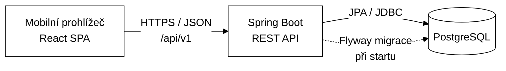
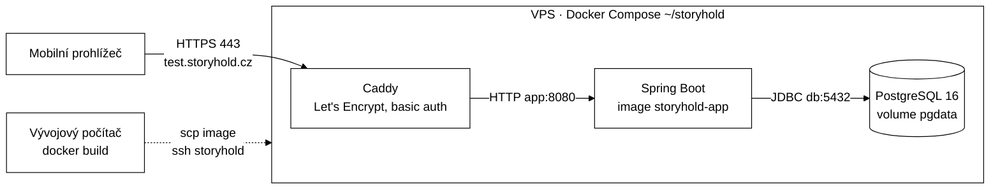

# 02 — Architektura

## 1. Přehled

Klasická třívrstvá webová aplikace: React SPA (mobilní prohlížeč) → REST API ve Spring Bootu → PostgreSQL. Stejný stack v prototypu i v ostrém provozu.



### Klíčová rozhodnutí

| Rozhodnutí | Volba | Důvod |
|---|---|---|
| Typ klienta | SPA (React), později PWA | Bez instalace, jeden kód pro všechny telefony |
| Komunikace | REST + JSON, verze `/api/v1` | Jednoduché, dobře testovatelné |
| Stav hry | Na serveru (tabulka `game_session` + `session_progress`) | Odpovědi se ověřují na serveru, hra přežije zavření prohlížeče, data pro analytiku |
| Identita hráče | Anonymní token relace (UUID v4) v `localStorage` + hlavička `X-Session-Token` | Žádné účty, žádné osobní údaje |
| Obsah her | V DB, v prototypu nahraný Flyway seed migrací | Připraveno na budoucí administraci |
| Schéma DB | Flyway, `ddl-auto=validate` | Kontrolované změny schématu |
| Nasazení | Jeden Spring Boot JAR, který servíruje i build frontendu (`static/`) | Jedna jednotka nasazení, žádné CORS v produkci |

## 2. Backend

### Technologie

- Java 21 LTS, Spring Boot 4.1 (Hibernate 7, Jackson 3), Maven Wrapper
- Starters: `webmvc`, `data-jpa`, `validation`, `actuator`, `flyway` (ve Spring Boot 4 má Flyway vlastní starter) + `flyway-database-postgresql`, `postgresql` driver
- Testy: `spring-boot-starter-*-test` (např. `webmvc-test`, `data-jpa-test`), `spring-boot-testcontainers`, Testcontainers (`testcontainers-postgresql`, `testcontainers-junit-jupiter`)
- Lombok **nepoužívat** — DTO jsou `record`, entity s ručními gettery/settery.

### Balíčky (package-by-feature)

```
cz.mibcon.zazitky            # (název balíčku lze upravit)
├── ZazitkyApplication.java
├── common/                  # ApiExceptionHandler (ProblemDetail), ApiException + NotFound/InvalidState,
│                            # TextNormalizer, ClockConfig (Clock bean), SpaWebConfig (frontend), SpaPages (routy aplikace, 404),
│                            # RateLimiter + RateLimitConfig, TooManyRequestsException (429)
├── admin/                   # přístupy do administrace
│   ├── domain/              # PartnerUser (účet správy hradu)
│   ├── AdminSecurityConfig  # Spring Security: role ADMIN (konfigurace) a PARTNER (DB)
│   ├── AdminSessionController # /api/v1/admin/session
│   ├── PartnerAdminService, PartnerAdminController # hrady: firemní údaje, historie podílů (/api/v1/admin/partners)
│   ├── PartnerUserService, PartnerUserAdminController # správa účtů hradů (/api/v1/admin/partner-users)
│   └── PartnerPortalController # /api/v1/partner/** — přehled hradu, jen data vlastního partnera
├── game/                    # čtení obsahu
│   ├── domain/              # Partner, Location, Game, Station, Hint, AcceptedAnswer, StationChoice + enumy
│   ├── *Repository.java     # jedno repository na tabulku
│   ├── GameService.java     # detail hry pro úvod (z ověření kódu)
│   ├── GameAdminController  # /api/v1/admin/games
│   └── GameDetailDto
├── session/                 # herní logika
│   ├── domain/              # GameSession, SessionProgress, AnswerAttempt + enumy
│   ├── SessionService.java
│   ├── AnswerEvaluator.java # normalizace + porovnání odpovědí
│   ├── SessionController.java # /api/v1/sessions
│   ├── SessionDtos.java     # request/response recordy
│   ├── SessionRetention.java # denně smaže názvy týmů 12 měsíců po vypršení kódu (/ochrana-udaju)
│   └── InvalidTokenException (401), SessionExpiredException (410)
└── accesscode/              # přístupové kódy
    ├── domain/              # AccessCodeBatch, AccessCode + AccessCodeStatus
    ├── AccessCodeFormat     # normalizace, formát ABCD-2345, generování (SecureRandom)
    ├── AccessCodeService    # ověření, aktivace, expirace kódu
    ├── AccessCodeController # /api/v1/access-codes/check
    ├── AccessCodeAdminService + AccessCodeAdminController # dávky, předání, CSV, měsíční přehled, souhrn (/api/v1/admin/**)
    └── InvalidCodeException (404), CodeExpiredException (410)
```

### Vrstvy uvnitř feature

`Controller` (HTTP, validace vstupu, mapování na DTO) → `Service` (transakce, herní pravidla) → `Repository` (Spring Data JPA). Controllery neobsahují logiku, entity neopouštějí service vrstvu.

### Herní logika (`SessionService`)

1. **start(code, teamName)** — `AccessCodeService` ověří kód (neznámý/zrušený, dávka ještě nepředaná partnerovi, nebo hra není `PUBLISHED` → 404 `invalid-code`, vypršelý → 410 `code-expired`) a při prvním použití ho aktivuje (`ACTIVATED`, `activated_at`, `valid_until = activated_at + batch.validity_hours`). Pokud kód už má rozehranou (`IN_PROGRESS`, nevypršelou) nebo dokončenou relaci, vrátí ji i s tokenem (pokračování na jiném zařízení) — kromě dávek s `multi_session`, kde každé zadání založí novou hru. Jinak vytvoří `game_session` (`IN_PROGRESS`, `token = UUID.randomUUID()`, `expires_at = min(now + session_validity_hours, valid_until kódu)`) a `session_progress` pro první stanoviště (`ACTIVE`). Opuštěnou hru (`ABANDONED`) lze během platnosti kódu začít znovu.
2. **getState(token)** — vrátí aktuální stav; pokud je relace `IN_PROGRESS` a `expires_at <= now`, nastaví `EXPIRED` a vrátí 410 (změna stavu se uloží, `noRollbackFor`).
3. **submitAnswer(token, stationId, answer)** — v transakci:
   - stanoviště musí být aktuálně `ACTIVE` v dané relaci (jinak 409);
   - zapíše `answer_attempt` (každý vyhodnocený pokus, i špatný; požadavek odmítnutý 401/404/409/410 se nezapisuje);
   - `AnswerEvaluator` normalizuje vstup a porovná s `accepted_answer.normalized_value`;
   - při úspěchu: progress → `SOLVED`, `solved_at`; další stanoviště → `ACTIVE`; pokud žádné není, relace → `COMPLETED`, `finished_at`.
4. **revealHint(token, stationId)** — zvýší `hints_used` (max. počet nápověd stanoviště) a připočte penalizaci do `penalty_seconds` relace; vrátí odkryté nápovědy.

5. **abandon(token)** — `IN_PROGRESS` → `ABANDONED`; opakované volání je bez efektu, u `COMPLETED` 409.

Časy se berou z beanu `Clock` (testovatelnost). Souběh: dvojité odeslání z jednoho telefonu ošetřuje optimistické zamykání — `@Version` na `game_session` a načítání relace s `OPTIMISTIC_FORCE_INCREMENT` u všech zápisových operací.

### Normalizace odpovědí (`TextNormalizer` v `common`)

```
trim → toLowerCase(Locale.ROOT) → Normalizer.Form.NFD + odstranit \p{M} (diakritika)
     → odstranit interpunkci [^\p{L}\p{N} ] → sloučit mezery
NUMBER: navíc odstranit vše kromě číslic
```

Normalizovaná hodnota se ukládá do `accepted_answer.normalized_value`. **Rozhodnuto v M2:** v seedu se vyplňuje ručně a integrační test `DemoGameSeedTest` hlídá, že odpovídá výstupu `TextNormalizer`. Budoucí administrace ji bude dopočítávat při zápisu přes service. Pro typ `NUMBER` se používá `normalizeNumber`, pro `TEXT` a `CHOICE` `normalize`.

### Chyby

`@RestControllerAdvice` vrací `ProblemDetail` (RFC 9457):

| Situace | HTTP | `type` (suffix) |
|---|---|---|
| Hra/relace/stanoviště nenalezeno | 404 | `not-found` |
| Neplatný vstup (validace) | 400 | `validation` |
| Odpověď na neaktivní stanoviště, hra není rozehraná | 409 | `invalid-state` |
| Relace vypršela | 410 | `session-expired` |
| Chybí/nesedí token relace | 401 | `invalid-token` |
| Neznámý, zrušený nebo ještě nepředaný („ve výrobě“) přístupový kód | 404 | `invalid-code` |
| Přístupový kód vypršel | 410 | `code-expired` |
| Příliš mnoho pokusů o kód / přihlášení z jedné IP | 429 | `too-many-requests` |
| Admin/partner API bez přihlášení / špatné heslo nebo zablokovaný účet | 401 | `unauthorized` / `invalid-credentials` |
| Hrad (role `PARTNER`) volá API správce, nebo správce API hradu | 403 | `forbidden` |
| Admin API bez platného CSRF tokenu | 403 | `forbidden` |

`type` je relativní URI `/problems/<suffix>` (např. `/problems/not-found`), `title` a `detail` jsou česky. Validační chyby těla požadavku obsahují navíc pole `errors: [{ "field", "message" }]`. Neznámá hra nebo nepublikovaná hra vrací 404.

### Konfigurace a profily

- `application.yml` — společné; `spring.jpa.hibernate.ddl-auto=validate`, `spring.jpa.open-in-view=false`
- `application-dev.yml` — lokální DB z docker-compose, Flyway `locations: classpath:db/migration,classpath:db/seed`
- `application-prod.yml` — jen `db/migration`, nastavení z proměnných prostředí:

| Proměnná | Význam |
|---|---|
| `DB_URL`, `DB_USER`, `DB_PASSWORD` | připojení k PostgreSQL |
| `ADMIN_USERNAME` (výchozí `admin`), `ADMIN_PASSWORD` | účet správce aplikace (role `ADMIN`); bez hesla se správce nepřihlásí (účty hradů v DB fungují dál) |
| `PUBLIC_URL` | veřejná adresa pro odkazy v CSV s kódy (QR na kartičce), např. `https://hra.example.cz` |
| `SESSION_COOKIE_SECURE` (výchozí `true`) | session cookie administrace jen přes HTTPS; `false` jen pro lokální test |
| `FORWARD_HEADERS_STRATEGY` (výchozí `none`) | za reverzní proxy `native`, aby limit pokusů počítal skutečné IP hráčů |

- `application.yml` — limity `app.access-code.attempts-per-minute` (10) a `app.admin.login-attempts-per-minute` (5).
- `application-dev.yml` — admin `admin` / `admin` (jen lokálně).
- Hesla a tajemství nikdy v repozitáři.

## 3. REST API (v1)

Base path: `/api/v1`. Všechny odpovědi JSON. Relace se identifikuje hlavičkou `X-Session-Token: <uuid>`.

### Přístupové kódy

Hráč hru nevybírá — hra se pozná podle kódu z kartičky. (Veřejný seznam her `GET /games` z prototypu byl zrušen.)

| Metoda | Cesta | Popis |
|---|---|---|
| POST | `/access-codes/check` | Ověřit kód (neaktivuje ho). Body: `{ "code": "abcd 2345" }` — velikost písmen, mezery a pomlčky nehrají roli. Limit 10 pokusů/min na IP (společně s `POST /sessions`). |

```json
// POST /access-codes/check → 200
{
  "code": "ABCD-2345",
  "game": { "id": "4b0c…", "title": "Prokletí loketského kata", "subtitle": "…", "introText": "Píše se rok 1625…",
            "introAudioUrl": "/audio/demo/intro.mp3", "coverImageUrl": "/images/demo/cover.webp",
            "estimatedMinutes": 45, "stationCount": 5 },
  "resumesGame": false,       // true = kód už je použitý, POST /sessions vrátí jeho rozehranou hru
  "validUntil": null          // po aktivaci konec platnosti; null i u vývojového kódu bez expirace
}
```

### Relace

| Metoda | Cesta | Popis |
|---|---|---|
| POST | `/sessions` | Zahájit hru kódem. Body: `{ "code": "ABCD-2345", "teamName": "Kuchtovi" }` → `201` + stav relace včetně `token`; když kód pokračuje v existující hře, `200` + její stav a token (`teamName` se ignoruje) |
| GET | `/sessions/current` | Aktuální stav relace (pro obnovu i po každém kroku) |
| POST | `/sessions/current/sync` | Akce zahrané v telefonu (offline), v pořadí: `{ "events": [ { "id": "<uuid z telefonu>", "type": "ANSWER", "stationId": "…", "answer": "…", "at": "2026-10-31T10:05:00Z" }, { "id": "…", "type": "HINT", "stationId": "…", "at": "…" } ] }` → stav relace. Stejná pravidla jako jednotlivé požadavky, ale v čase hraní; už přijatá akce (stejné `id`) se přeskočí, akce, kterou pravidla už nedovolí (stanoviště vyřešené jinde, žádná další nápověda), se zapíše bez účinku. Čas se drží mezi startem hry a přijetím a nejde zpět. Akce z doby platnosti kódu platí i po jejím vypršení; když hra ani tak není dokončená, odpověď je `410` (akce zůstanou zapsané). Max. 500 akcí |
| GET | `/sessions/current/package` | Offline balíček rozehrané hry (`SessionPackage`): první stanoviště otevřeně, ostatní obsah zašifrovaný odpověďmi, klíče už vyřešených stanovišť, pořadí tajenky, seznam obrázků a zvuků, údaje relace (název hry, tým, start, platnost). Bez přijímaných odpovědí. Hra mimo `IN_PROGRESS` a `COMPLETED` → `409` |
| POST | `/sessions/current/stations/{stationId}/answers` | Odeslat odpověď. Body: `{ "answer": "1625" }` |
| POST | `/sessions/current/stations/{stationId}/hints` | Odkrýt další nápovědu → odkryté nápovědy a nová penalizace |
| POST | `/sessions/current/abandon` | Opustit hru → `204` (opakované volání je bez efektu) |

```json
// GET /sessions/current
{
  "token": "e3f1…",            // jen v odpovědi na POST /sessions
  "status": "IN_PROGRESS",
  "game": { "id": "4b0c…", "title": "Prokletí loketského kata" },
  "teamName": "Kuchtovi",
  "startedAt": "2026-10-28T10:15:00Z",
  "penaltySeconds": 60,
  "progress": { "solved": 1, "total": 5 },
  "currentStation": {
    "id": "a1…",
    "orderNo": 2,
    "title": "Katova studna",
    "storyText": "…",
    "storyAudioUrl": "/audio/demo/st02-pribeh.mp3", // null = jen text
    "listenOnly": false,       // true = poslechová úloha, text příběhu jen jako přepis na vyžádání
    "imageUrl": "/images/demo/st02.webp", "imageAlt": "…", // null = bez obrázku
    "taskText": "Kolik kroků vede…?",
    "taskType": "NUMBER",
    "choices": null,
    "hintsAvailable": 1,       // počet ještě neodkrytých nápověd
    "nextHintPenaltySeconds": 120, // penalizace za další nápovědu, null když už žádná není
    "revealedHints": [ { "orderNo": 1, "text": "…", "penaltySeconds": 60 } ]
  },
  "solvedStations": [ { "id": "…", "orderNo": 1, "title": "…", "rewardText": "…", "rewardAudioUrl": null, "nextText": "…" } ],
  "puzzle": { "slots": [null, "P", null, null, null, null, null, null, null], "latestSlot": 1 },
                              // tajenka: písmena vyřešených stanovišť zpřeházeně (pořadí pevné pro hru, odvozené z id relace),
                              // null = ještě nezískané; latestSlot = písmeno z posledního vyřešeného; null, když hra tajenku nemá
  "finale": null              // po dokončení: { "outroText": "…", "totalSeconds": 2710, "hintsUsed": 3 }
}
```

```json
// POST …/answers  → 200
{ "correct": false, "message": "To není ono. Zkus to znovu." }   // u NUMBER bez číslic: "Odpověď musí obsahovat číslo."
{ "correct": true, "rewardText": "…", "rewardAudioUrl": "…", "nextText": "Vystoupej k hradní bráně.",
  "nextStationId": "b2…", "gameCompleted": false }
// poslední stanoviště: nextStationId (a obvykle i nextText) chybí, gameCompleted = true
```

```json
// POST …/hints  → 200
{ "revealedHints": [ { "orderNo": 1, "text": "…", "penaltySeconds": 60 } ],
  "hintsAvailable": 1, "nextHintPenaltySeconds": 120, "penaltySeconds": 60 }
```

**Pravidla a stavové kódy relací** (kontroly v tomto pořadí):

1. Chybí, je poškozený nebo neznámý `X-Session-Token` → `401 invalid-token`.
2. Relace `IN_PROGRESS` s `expires_at <= now` se při jakémkoli přístupu přepne na `EXPIRED` (změna se uloží) → `410 session-expired`; to platí i pro `GET /sessions/current`.
3. Odpověď / nápověda, když relace není `IN_PROGRESS` (`COMPLETED`, `ABANDONED`) → `409 invalid-state`. `GET /sessions/current` vrací u `COMPLETED` a `ABANDONED` normálně stav (`200`).
4. Stanoviště, které do hry nepatří → `404 not-found`; stanoviště, které ještě není odemčené nebo už je vyřešené → `409 invalid-state`.
5. Další nápověda, když už žádná nezbývá → `409 invalid-state`.
6. Odmítnutý požadavek (body 1–5) se nezapisuje do `answer_attempt`; každý vyhodnocený pokus ano.
7. Každá zápisová operace zvyšuje `game_session.version` (`OPTIMISTIC_FORCE_INCREMENT`), takže ze dvou souběžných požadavků na stejnou relaci uspěje jen jeden, druhý dostane `409 invalid-state`.

### Administrace (`/api/v1/admin/**`)

Přihlášení formulářem (Spring Security), session cookie, CSRF ochrana pro SPA: `GET /admin/session` vydá cookie `XSRF-TOKEN`, každý POST ji vrací v hlavičce `X-XSRF-TOKEN`. Jedno přihlášení pro dvě role:

- `ADMIN` — správce aplikace, jeden účet z konfigurace (`ADMIN_USERNAME` / `ADMIN_PASSWORD`), smí `/api/v1/admin/**`.
- `PARTNER` — správa hradu, účty v tabulce `partner_user`, smí jen `/api/v1/partner/**`; partner se bere z přihlášení, nikdy z požadavku.

| Metoda | Cesta | Popis |
|---|---|---|
| GET | `/admin/session` | `{ "username", "role": "ADMIN" \| "PARTNER", "partnerName" }`, bez přihlášení vše `null`; vydá CSRF cookie |
| POST | `/admin/login` | Form `username`, `password` → `200` stejné tělo jako `/admin/session` / `401`; limit 5 pokusů/min na IP; platí pro obě role |
| POST | `/admin/logout` | `204` |
| GET | `/admin/games` | Hry pro výběr při generování (`id`, `title`, `status`, `partnerName`) |
| GET | `/admin/dashboard?year=2026[&partnerId=…]` | Souhrn za rok (všechny hrady nebo jeden): `activatedThisMonth`, `activatedInYear`, `revenueCzk`, `partnerShareCzk`, `profitCzk` (= tržba − podíl hradů), `revenueThisMonthCzk`, `partnerShareThisMonthCzk`, `profitThisMonthCzk` (aktuální měsíc i při jiném zvoleném roce; hrad dostane bez zisku), `cardsInStock` (podle inventur hradů, jinak předané a neaktivované), `cardsInStockComputed`, `stockCountedAt` (jen pro jednoho partnera), `cardsInProduction`, `cardsDelivered`; vývojové dávky se nepočítají |
| GET | `/admin/batches[?partnerId=…]` | Dávky kódů: `handedOverAt` (null = ve výrobě), `activatedCount`, `notActivatedCount` |
| POST | `/admin/batches` | Nová dávka: `gameId`, `quantity` (1–5000), `validityHours` (1–24, v UI předvyplněno 5), `note`, `unitPriceCzk` → `201`; partner se doplní ze hry; dávka je **ve výrobě** — kódy nefungují |
| POST | `/admin/batches/{id}/handover` | Kartičky byly předány partnerovi → od teď kódy fungují a partner dávku vidí |
| DELETE | `/admin/batches/{id}/handover` | Vrátit předání (omyl) — jen dokud z dávky nikdo nic nepoužil, jinak `409` |
| GET | `/admin/batches/{id}/codes.csv` | CSV pro tiskárnu kartiček: UTF-8 s BOM, oddělovač `;`, sloupce `kod;odkaz` (`<PUBLIC_URL>/?kod=ABCD-2345` pro QR) |
| GET | `/admin/reports/monthly-activations?year=2026[&partnerId=…]` | Aktivované kódy po měsících (Europe/Prague), partnerech a hrách: `month`, `partnerId`, `partnerName`, `gameTitle`, `activatedCount`, `revenueCzk` (součet cen), `partnerShareCzk` (součet cena × podíl platný v den aktivace kódu); vývojové dávky se nepočítají |
| GET | `/admin/reports/partners?year=2026` | Srovnání všech hradů: `activatedInYear`, `revenueCzk`, `partnerShareCzk`, `profitCzk` (jako měsíční přehled), `cardsDelivered`, `cardsInStock` (podle inventury hradu), `cardsInStockComputed`, `stockCountedAt`, `cardsInProduction`, `activatedLast28Days`, `stockDays` (hra, které kartičky dojdou nejdřív) a `games[]` (totéž po hrách) (na kolik dní vydrží kartičky u hradu při tempu posledních 28 dní, `null` bez prodeje); i hrady bez kartiček; vývojové dávky se nepočítají |
| GET | `/admin/reports/gameplay?year=2026[&partnerId=…]` | Jak se hraje: hry spuštěné v roce (Europe/Prague) kódy z prodaných kartiček, po hrách: `started`, `completed`, `unfinished` (opuštěné nebo vypršelé), `playing`, doba hraní dohraných her v sekundách (`durationP25Seconds`, `durationMedianSeconds`, `durationP75Seconds`, `durationWithPenaltyMedianSeconds`) a `stations[]` (`reached`, `solved`, `stoppedHere`, `medianSeconds` od odemčení po vyřešení, `wrongAttempts`, `teamsWithHint`). Jen pro správce, hrad vidí jen prodej |
| GET | `/admin/partners`, `/admin/partners/{id}` | Partneři (hrady): `id`, `name`, `companyId` (IČ), `vatId` (DIČ), `contactEmail`, `contactPerson`, `phone`, `currentSharePct` (platný dnes), `shares` (`id`, `validFrom`, `sharePct`, včetně naplánovaných) |
| POST | `/admin/partners` | Přidat partnera: `name` (povinné), `companyId` (8 číslic, unikátní), `vatId` (např. CZ12345678), `contactEmail`, `contactPerson`, `phone` → `201`; podíl se nastaví zvlášť |
| PUT | `/admin/partners/{id}` | Upravit firemní údaje (stejná pole jako POST) → `200` |
| POST | `/admin/partners/{id}/shares` | Podíl od data: `validFrom` (YYYY-MM-DD), `sharePct` (0–100, max. 2 desetinná místa) → `200` + hrad; stejné datum nahradí existující podíl; datum v minulosti změní vyúčtování už aktivovaných kódů (UI upozorní) |
| DELETE | `/admin/partners/{id}/shares/{shareId}` | Smazat podíl (např. chybně naplánovaný) → `200` + hrad |
| GET | `/admin/partner-users` | Účty hradů (`username`, `displayName`, `partnerName`, `enabled`, `createdAt`, `lastLoginAt`) |
| POST | `/admin/partner-users` | Nový účet: `partnerId`, `username` (3–100, písmena bez diakritiky, číslice, `._@-`; ukládá se malými písmeny), `displayName`, `password` (min. 10 znaků) → `201`; obsazené jméno nebo jméno správce → `400` |
| POST | `/admin/partner-users/{id}/password` | Nové heslo `{ "password" }` → `204` |
| POST | `/admin/partner-users/{id}/enabled` | `{ "enabled": false }` zablokuje přihlášení (otevřená session doběhne) → `204` |

### Přehled pro hrad (`/api/v1/partner/**`, role `PARTNER`)

| Metoda | Cesta | Popis |
|---|---|---|
| GET | `/partner/reports/monthly-activations?year=2026` | Jako přehled správce, jen řádky vlastního partnera |
| GET | `/partner/summary?year=2026` | Vlastní souhrn: kartiček na skladě (`cardsInStock` podle poslední inventury hradu, jinak předané a neaktivované; `cardsInStockComputed` podle aktivací; `stockCountedAt`; `games[]` totéž po hrách), převzato celkem, aktivace, tržba, podíl (bez zisku provozovatele) |
| POST | `/partner/stock-count?year=2026` | Inventura po hrách: `{ "games": [{ "gameId", "cardsInStock" }] }` = kolik kartiček každé hry hrad opravdu má (prodané neaktivované už ne) → aktualizovaný souhrn; víc než `cardsInStockComputed` hry nebo hra bez převzatých kartiček → `400`. Dál se počítá od inventury hry (+ předané, − aktivované po ní, nejvýš počet podle aktivací); vyúčtování se nemění |
| GET | `/partner/batches` | Převzaté dávky (jen předané, bez vývojových): datum předání, kusů, aktivováno, zbývá (`notActivatedCount`) — podklad pro inventuru kartiček |
| GET | `/partner/shares` | Vlastní podíly včetně naplánovaných (`validFrom`, `sharePct`) |
| POST | `/partner/password` | Změna vlastního hesla `{ "currentPassword", "newPassword" }` → `204`; špatné současné heslo → `400` |

`choices` u typu `CHOICE` je seznam textů k výběru (které z nich jsou správné, klient nezjistí).

## 4. Frontend

### Technologie

React + TypeScript (strict), Vite, React Router, TanStack Query (stav serveru), Tailwind CSS. Žádný Redux — stav hry žije na serveru, lokálně jen token.

### Struktura

```
frontend/src/
├── api/            # fetch klient (+ X-Session-Token), typy DTO, query hooks
├── pages/          # HomePage (zadání kódu), StartPage, StationPage, RewardPage, FinalePage
├── admin/          # AdminPage (přihlášení; správce: levé menu PartnerNav + /admin = Dashboard,
│                   # /admin/partneri/:id = PartnerDetail se záložkami ?sekce=prehled|kody|podily|udaje|ucty;
│                   # hrad: CastleOverview + PasswordButton v hlavičce), StatCards (karty souhrnu), YearSelect,
│                   # PartnerForm (firemní údaje), ShareHistory, NewBatchForm, BatchList (stav a předání dávek),
│                   # MonthlyReport, PartnerUsers, Tabs, ChangePasswordForm, adminApi (CSRF hlavička)
├── components/     # ProgressBar, AnswerInput (TEXT/NUMBER/CHOICE), HintList, StoryText, ErrorBanner
├── session/        # tokenStorage (localStorage s try/catch), SessionTokenProvider, usePlaySession
├── queryClient.ts  # TanStack Query (bez retry u 4xx)
├── App.tsx         # routy
└── main.tsx
```

### Routy

| Cesta | Stránka |
|---|---|
| `/` | Úvodní stránka StoryHold (logo v hlavičce) podle návrhu `docs/image.png`: úvod s obrázkem hradu Loket přes celou sekci (`public/images/hero.jpg`, na telefonu a tabletu nad textem, od šířky `lg` pod textem se ztmavením zleva) a ukázkou hry v mobilu (jen od šířky `xl`, aby nezakrývala hrad), zadání kódu ve tvaru XXXX-XXXX (pomlčka se doplní sama po 4 znacích, z QR odkazu `?kod=` se kód hned ověří: nová hra jde rovnou na „Než začnete“ na `/start` (ověření kód neaktivuje), rozehraná hra pokračuje, neplatný kód zůstane v poli s důvodem a stránka se k němu posune; `?kod=` se z adresy odstraní, aby návrat zpět hru nespustil znovu), „Pokračovat ve hře“ pokud je token, tři kroky, „Naše hry“ (demo Katova povinnost, tlačítko „Zahrát ukázku“ použije kód DEMO-KATA), jak hra probíhá, „Než vyrazíte“ (tipy: mobil, sluchátka, data, obuv), „Časté otázky“ (rozbalovací `<details>`, odpovědi musí odpovídat skutečnému chování hry), „Proč StoryHold“ (vznik a vzdělávací smysl hry, psáno neosobně za StoryHold), „Pro památky“ (krátká nabídka pro správce bez obchodních podmínek, výzva ozvat se, e-mail s předvyplněným předmětem), patička s kontaktem. Obsah je v `index.html` předgenerovaný při buildu, viz [Vyhledávače (SEO)](#vyhledávače-seo) |
| `/ochrana-udaju` | Informace o zpracování osobních údajů a o ukládání v prohlížeči (Q17), odkaz v patičce. Úvodní stránka i tato sdílí `SiteLayout` (tmavá hlavička s logem, patička s odkazem „Provozovatel a ochrana osobních údajů“; údaje provozovatele v `components/operator.ts`) |
| `/pravidla` | Pravidla hry: kartička a platnost kódu, průběh, bezpečnost na památce, co dělat při potížích; odkaz v patičce a z Častých otázek |
| `*` | Stránka 404 ve vzhledu webu (`SiteLayout`), server vrací status 404 |
| `/start` | Nejdřív „Než začnete“: upozornění na namluvený zvuk (vypnout tichý režim, sluchátka) a bezpečnost na památce, tlačítka „Pustit úvod“ (zapne hlas) a „Hrát bez zvuku“ (ztlumí, `zazitky.voiceMuted`). Klepnutí zároveň dovolí prohlížeči spustit zvuk úvodu. Pak úvod hry z ověřeného kódu, název týmu, „Začít hru“ (kód jen v navigačním stavu, ne v URL) |
| `/play` | Aktuální stanoviště (podle `GET /sessions/current`) |
| `/play/reward` | Odměna po vyřešení |
| `/play/finale` | Finále |
| `/admin` | Administrace — správce: dashboard; hrad: přehled hradu |
| `/admin/partneri/:partnerId` | Detail hradu (jen správce) |

Navigace ve hře je řízená stavem ze serveru — klient nikdy sám nerozhoduje, které stanoviště je odemčené.

### Chování klienta (M4)

- Token relace je v `localStorage` pod klíčem `zazitky.sessionToken`. Když úložiště není dostupné (anonymní okno), hra funguje do obnovení stránky.
- Stránky `/play*` načítají `GET /sessions/current`. Bez tokenu nebo při `401`/`410` klient token smaže a vrátí hráče na úvod se zprávou ze serveru.
- Po správné odpovědi klient přejde na `/play/reward` s textem odměny; stav relace se obnoví až tam (jinak by stránka stanoviště přesměrovala dřív, než se odměna zobrazí). Po reloadu odměnové stránky se zobrazí odměna posledního vyřešeného stanoviště.
- **Namluvené texty:** úvod hry, příběh stanoviště, odměna a závěr mohou mít zvuk (MP3, pole `introAudioUrl`, `storyAudioUrl`, `rewardAudioUrl`, `outroAudioUrl`; null = jen text). `VoicePlayer` zvuk po otevření stránky zkusí spustit sám (prohlížeč to obvykle dovolí, protože předcházelo klepnutí hráče); když to prohlížeč zablokuje (hlavně iPhone), zůstává tlačítko „Poslechnout“. „Ztlumit“ si zařízení pamatuje v `localStorage` (`zazitky.voiceMuted`) a další texty se pak samy nespouští. Text zůstává na obrazovce jako titulky. Soubory jsou zatím ve `frontend/public/audio/` (zabalí se do JAR, server podporuje Range požadavky, které iPhone pro přehrávání vyžaduje).
- **Obrázky a vedení hráče:** úvod hry (`coverImageUrl`) a stanoviště (`imageUrl`, `imageAlt`) mohou mít obrázek ve `frontend/public/images/`, jako WebP 900 px široký (`tools/grafika/web_images.py` z předlohy v `grafika/`; hra je celá stahuje do telefonu, demo: 11 obrázků = 1 MB). Chybí-li soubor (nahrávka nebo obrázek se teprve připravuje), přehrávač i obrázek se skryjí a hra jde dál jen s textem. U poslechové úlohy (`listenOnly`) je text příběhu skrytý za tlačítkem „Zobrazit přepis“; když nahrávka chybí, zobrazí se text rovnou. Pod odměnou je rámeček „Kam dál“ (`nextText`).
- **Tajenka:** hra si písmena pamatuje za hráče. Na stanovišti i u odměny je řádek „Tajenka“ se získanými písmeny, zpřeházenými, aby poslední krok zůstal hádankou; u odměny je nově získané písmeno zvýrazněné (`puzzle.latestSlot`).
- `NUMBER` používá textové pole s `inputMode="numeric"` (numerická klávesnice, ale odpověď typu „56 schodů“ projde). `CHOICE` jsou velká tlačítka, klepnutí rovnou odešle odpověď.
- Nápověda stojí čas, proto se odkrývá až po potvrzení, které ukazuje výši penalizace (`nextHintPenaltySeconds`).
- Zahájení nové hry při existujícím tokenu nejdřív zavolá `abandon` na starou relaci.

### Vývoj

Vite dev server na `:5173` s proxy `/api → http://localhost:8080`.

**Produkční build (rozhodnuto v M5):** `backend/pom.xml` přidává `../frontend/dist` jako resource do `static/` — bez frontend pluginu v Mavenu, backendové testy tak nepotřebují Node. Postup: `cd frontend && npm run build`, pak `cd backend && ./mvnw package`; když `dist` neexistuje, JAR je jen backend. `Dockerfile` dělá totéž ve dvou fázích. `SpaWebConfig` servíruje statické soubory, `/` je `index.html` s předgenerovanou úvodní stránkou. Routy aplikace (`/ochrana-udaju`, `/pravidla`, `/start`, `/play…`, `/admin…`) vrací `SpaPages` jako `app.html`. Ostatní cesty bez tečky mimo `/api/` a `/actuator/` vrací `404` s `app.html` (aplikace ukáže „Stránka nenalezena“), chybějící soubory a API `404` jako ProblemDetail. HTML stránky mají `Cache-Control: no-cache` a `ETag` z obsahu souboru (ne `Last-Modified`: soubory v JAR mají kvůli reprodukovatelnému buildu všechny datum 1980, prohlížeč by po nasazení dostal `304` a zůstal u staré `index.html`), hashované `/assets/**` cache na rok (`immutable`).

### Vyhledávače (SEO)

Rozhodnuto 2026-10-30 (Q16). Indexovat se má jen úvodní stránka na `https://storyhold.cz/`; hra a administrace do vyhledávačů nepatří.

- **Hlavička `index.html`:** výstižný `<title>`, `description`, kanonická adresa `https://storyhold.cz/` (sjednotí i odkazy z QR `/?kod=…`), Open Graph s absolutní adresou obrázku (`og:url`, `og:image`), strukturovaná data JSON-LD (`Organization` s logem a kontaktem, `WebSite`). Adresy jsou natvrdo na produkční doménu, testovací server je stejně skrytý.
- **Předgenerování úvodní stránky:** `npm run build` po `vite build` spustí `prerender.mjs`. Ten přes Vite SSR build vykreslí `src/prerender.tsx` (`HomePage` přes `renderToString`, bez tokenu a bez `?kod=`) a vloží HTML do `dist/index.html`. Původní prázdnou stránku uloží jako `dist/app.html` pro ostatní routy, aby hra při načtení neprobleskla úvodní stránkou. Vyhledávače (hlavně Seznam, který JavaScript zpracuje jen omezeně) a náhledy odkazů tak vidí obsah bez JavaScriptu a stránka se dřív vykreslí. Aplikace pak obsah překreslí přes `createRoot` (ne hydratace: stav z `localStorage` a `?kod=` se od předgenerované verze liší). Vite dev server používá `index.html` bez předgenerování.
- **`robots.txt`** zakazuje `/admin`, `/play`, `/start`, `/api/`, `/actuator/` a odkazuje na **`sitemap.xml`** (zatím jen `/`). Routy aplikace a stránka 404 mají navíc hlavičku `X-Robots-Tag: noindex` (`SpaPages`).
- **Neexistující adresy** vrací skutečnou `404`, ne úvodní stránku s `200` („soft 404“).
- **Rychlost:** hlavní obrázek úvodu má `fetchpriority="high"`, obrázek níž na stránce `loading="lazy"`.
- **Testovací server** zůstává za basic auth s `X-Robots-Tag: noindex, nofollow` (Caddy), do vyhledávačů se nedostane.
- **Později:** stránky pro jednotlivé lokality (např. `/hry/loket`) s vlastním textem, předgenerované stejným způsobem a přidané do sitemapy; po spuštění produkce registrace v Google Search Console a Seznam Webmaster.

### Offline režim (F6, rozhodnutí Q4)

Hráč musí projít hru i bez signálu (hradby, sklepení, letadlový režim). Zásada „správné odpovědi se neposílají na klienta“ platí dál.

1. **Aplikace offline (PWA):** `npm run build` po předgenerování vytvoří service worker (`workbox-build`, `service-worker.mjs`). Do mezipaměti uloží jen kostru aplikace (JS, CSS, HTML, písma, logo). Navigace bez signálu dostane `app.html` (úvod `index.html`). Obrázky a zvuky her se ukládají až s balíčkem hry (bod 2), návštěvníci úvodní stránky je nestahují. Zvuky ze schránky se servírují s podporou Range (iPhone).
2. **Herní balíček:** po „Začít hru“ klient stáhne balíček relace (`GET /sessions/current/package`, v `localStorage` jako `zazitky.gamePackage`, svázaný s tokenem) a všechny obrázky a zvuky hry do mezipaměti `game-media`. Stahuje se na pozadí (`prepareOffline`) po 4 souborech souběžně a v pořadí potřeby (úvod, stanoviště, závěr; co už je v mezipaměti, se přeskočí), hráč hned pokračuje na první stanoviště; na stanovišti řádek „Stahuji hru do telefonu… 12 z 33“, po dokončení „✓ Hra je stažená, můžete hrát i bez signálu“. Přerušené stahování (zavřený prohlížeč) se při dalším načtení hry dokončí; bez signálu se zkusí znovu později. Server zapečetí hru jednou a drží ji v paměti (`GamePackages`), PBKDF2 se 100 000 iteracemi je pomalé; po úpravě obsahu se musí vyřadit (dnes restart při nasazení). Obsah po každém úkolu (odměna, „Kam dál“, písmeno tajenky, další stanoviště s nápovědami, u posledního závěr) je zašifrovaný AES-GCM náhodným klíčem stanoviště. Ten je zabalený klíčem odvozeným z každé přijímané odpovědi (`PBKDF2-SHA256` z normalizované odpovědi, sůl hry). Telefon správné odpovědi nezná: odpověď hráče znormalizuje (`TextNormalizer` přepsaný do TypeScriptu, společné testovací případy s Javou), odvodí klíč a zkusí rozbalit. Číselné odpovědi a volby jde zkoušením uhodnout, u placené hry to akceptujeme. Nápovědy dalšího stanoviště jsou v zašifrovaném obsahu otevřeně (nejsou to odpovědi).
3. **Hra v telefonu:** se staženým balíčkem hraje telefon sám (`offline/localGame.ts`: stejný `SessionState`, `AnswerResult` a `HintsResult` jako server, takže herní stránky se nemění). Postup (vyřešená stanoviště s klíči, odkryté nápovědy, konec hry) a fronta akcí jsou v `localStorage` jako `zazitky.gameProgress`. `offline/playClient.ts` každou akci vyhodnotí v telefonu, zařadí do fronty a při signálu frontu pošle (krok 4: `POST /sessions/current/sync`; po `410` nebo `400` se fronta zahodí, bez signálu zůstává). Při načtení stavu převezme, co server ví navíc (stanoviště vyřešená na jiném telefonu — klíče z nového balíčku, nápovědy, konec hry). Platnost kódu hlídá telefon podle `expiresAt` z balíčku. Bez balíčku (starší hra, anonymní okno) jde vše na server jako dřív a balíček se stáhne na pozadí.
4. **Synchronizace:** fronta se posílá jedním požadavkem `POST /sessions/current/sync`, jakmile je signál (i při běžné hře online hned po každé akci). Server akce v pořadí znovu vyhodnotí stejnou logikou jako jednotlivé požadavky, v čase hraní (`answer_attempt.created_at`, `solved_at`, `finished_at`), a zapíše je do `session_event` (V10), takže opakované odeslání je bez efektu. Akce z doby platnosti kódu se přijmou i po jeho vypršení.

## 5. Bezpečnost

- Správné odpovědi a nápovědy, které hráč ještě neodkryl, nikdy neopouštějí server.
- Token relace = UUID v4 (122 bitů náhody), jen v hlavičce, ne v URL.
- Rate limiting odpovědí (ochrana proti hrubé síle u `NUMBER`) — zatím jen záznam pokusů, před ostrým provozem limit např. 10 pokusů/min na relaci (Q11).
- Přístupové kódy: 8 znaků z abecedy bez zaměnitelných znaků (bez 0/O, 1/I/L) → 31⁸ ≈ 8,5 · 10¹¹ kombinací, generované `SecureRandom`; ukládají se v plném znění (kvůli tisku), ověřování s limitem 10 pokusů/min na IP (v paměti, platí pro jednu instanci aplikace).
- Administrace: Spring Security, oddělený filter chain pro `/api/v1/admin/**` a `/api/v1/partner/**`, role `ADMIN` a `PARTNER`, hesla hradů BCrypt (session cookie `SameSite=Strict`, v prod `Secure`; CSRF; limit pokusů o přihlášení). Veřejné API je bez cookies (token v hlavičce), proto tam CSRF ani HTTP session nejsou.
- HTTPS v ostrém provozu povinné.

## 6. Nasazení

- Build: `npm run build` + `./mvnw package` → spustitelný JAR s vloženým frontendem, nebo Docker image z `Dockerfile` (multi-stage: Node → Maven → JRE, běží pod neprivilegovaným uživatelem, profil `prod`, `HEALTHCHECK` na `/actuator/health`). V image se nespouští testy (Testcontainers potřebují Docker) — spouští se předem / v CI.
- Lokální ověření image: `docker compose --profile app up -d --build` (aplikace na `:8080` proti PostgreSQL z compose, včetně demo hry přes `SPRING_FLYWAY_LOCATIONS`).

### Prostředí

| Prostředí | Adresa | Kde běží | Data |
|---|---|---|---|
| dev | `localhost:5173` / `:8080` | vývojový počítač, `docker-compose.yml` | profil `dev`, seed demo hry |
| staging | `https://test.storyhold.cz` | VPS, `~/storyhold` (`deploy/staging/`) | profil `prod` + seed demo hry, celé za basic auth, `noindex` |
| prod | `https://storyhold.cz` | stejný VPS, vlastní stack (zatím neexistuje) | profil `prod` bez seedu, bez basic auth |

### Server

- WEDOS VPS SSD (2 moduly: 4 GB RAM, 1 vlákno CPU, 30 GB SSD), Ubuntu 24.04 LTS, IP `31.31.75.96` / `2a02:2b88:2:1::7dd8:1`.
- Přístup jen SSH klíčem jako `michal` (sudo), root a hesla zakázané; nouzově KVM/VNC z administrace WEDOS.
- `ufw` povoluje jen 22, 80, 443; swap 2 GB; automatické bezpečnostní aktualizace; Docker Engine + Compose, logy kontejnerů rotované (10 MB × 3).
- **Porty zveřejňuje jen Caddy.** Docker pravidla `ufw` obchází, proto `app` a `db` nemají `ports:` a jsou dostupné jen ve vnitřní síti Compose.
- Image se na serveru **nebuilduje** (1 vlákno CPU): build na vývojovém počítači, na server přes `docker save` → `scp` → `docker load` (`deploy/deploy-staging.ps1`). Později GitHub Container Registry a CI.



Staging (`deploy/staging/`):

- `compose.yaml` — `caddy` (jediná s porty 80/443), `app` (`storyhold-app:staging`, limit 1 GB → heap ~770 MB, healthcheck `/actuator/health`), `db` (`postgres:16-alpine`, limit 512 MB, volume `pgdata`); vše `restart: unless-stopped`. Název projektu `storyhold` drží volume `caddy_data` s certifikáty.
- `Caddyfile` — `reverse_proxy app:8080`, basic auth se dvěma účty z proměnných (`BASIC_AUTH_*` pro tým, `PRESENTATION_AUTH_*` = `ukazka` pro prezentace), `X-Robots-Tag: noindex, nofollow`.
- Tajemství (`DB_PASSWORD`, `ADMIN_PASSWORD`, hash basic auth) jen v `~/storyhold/.env` na serveru (práva 600), vzor `deploy/staging/.env.example`. Každá služba dostane jen své proměnné.
- Pevně v `compose.yaml`: `PUBLIC_URL=https://test.storyhold.cz`, `FORWARD_HEADERS_STRATEGY=native`, `SESSION_COOKIE_SECURE=true`, `SPRING_FLYWAY_LOCATIONS=classpath:db/migration,classpath:db/seed`.
- Seed na stagingu vytvoří i vývojový kód `DEMO-KATA` a účet hradu `hrad` / `hrad-loket` (heslo je v repozitáři, za basic auth přijatelné). Heslo účtu jde v administraci změnit, ale každá změna `R__demo_game.sql` seed spustí znovu: vrátí heslo, smaže rozehrané hry demo hry a dávky kódů k ní (Q9).

### DNS a e-mail (`storyhold.cz`, WEDOS)

| Záznam | Hodnota |
|---|---|
| `test` A / AAAA | VPS |
| `@`, `*` A / AAAA | zatím parkovací stránka WEDOS, při spuštění produkce přesměrovat na VPS |
| MX, SPF, DKIM (`szn1–3._domainkey`) | Seznam Email Profi (`info@storyhold.cz`) |
| `_dmarc` | `p=none`, po ověření doručování `p=quarantine` |

### Provoz

- Monitoring: Actuator `/actuator/health` (healthcheck v Compose), logy na stdout (`docker compose logs -f app`).
- Zálohy DB (až budou ostrá data): denní `pg_dump` → šifrování (`age`/`gpg`) → WEDOS Disk přes rsync, retence 14 denních + měsíční.

## 7. Testování

| Úroveň | Co | Nástroj |
|---|---|---|
| Unit | `TextNormalizer`, `AnswerEvaluator`, výpočet času a penalizací | JUnit 5 |
| Integrace | Celý průchod demo hrou přes REST (start → odpovědi → nápovědy → finále), chybové stavy | `@SpringBootTest` + MockMvc + Testcontainers PostgreSQL |
| Migrace | Flyway proběhne na čisté DB, `ddl-auto=validate` projde | Testcontainers |
| Souběh | Dvě překrývající se změny jedné relace → druhá selže | `TransactionTemplate` + Testcontainers |
| SPA | `/` vrací `index.html`, routy aplikace `app.html` s `noindex`, neznámé stránky 404 s `app.html`, `/api` a chybějící soubory 404 | MockMvc |
| Předgenerování | Úvodní stránka z `src/prerender.tsx` obsahuje nadpis a obsah, bez „Pokračovat ve hře“ | Vitest |
| Frontend | `AnswerInput`, `HintList`, `formatDuration`, `tokenStorage`, toky v `App` (obnova po reloadu, 410 → úvod, odměna → finále) | Vitest + Testing Library (mock `fetch`) |
| Kódy | Aktivace, platnost 5 h, pokračování na jiném zařízení, opuštěná hra, vypršení, vývojový kód, limit pokusů | MockMvc + Testcontainers |
| Administrace | Přihlášení + CSRF, dávky, CSV, měsíční přehled bez vývojových kódů, srovnání hradů a statistiky hraní | MockMvc + `spring-security-test` |
| Účty hradů | Hrad vidí jen svá data, nedostane se k API správce, zakládání/blokace účtů, reset a změna hesla | MockMvc + Testcontainers |
| Ruční | Průchod demo hrou na šířce 360 px, administrace se skutečnou CSRF cookie | Playwright / DevTools, skutečný telefon |
