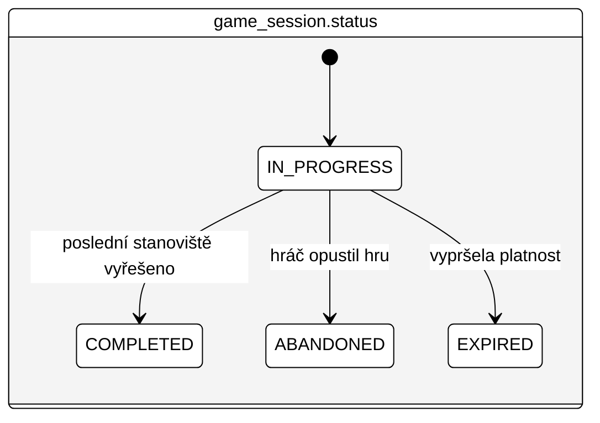
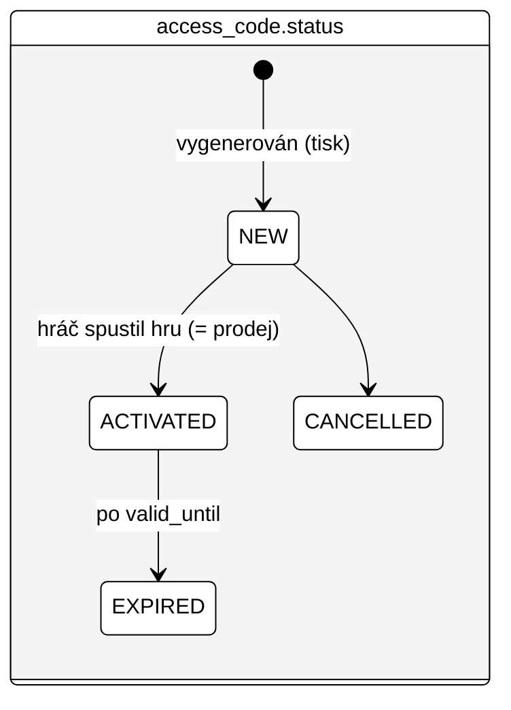

# 03 — Datový model

PostgreSQL 16+. Primární klíče `UUID` (`gen_random_uuid()`), časy `TIMESTAMPTZ`, enumy jako `VARCHAR` + `CHECK`. Názvy tabulek a sloupců anglicky, `snake_case`, jednotné číslo.

Model má tři oblasti:

- **Obsah** — partner, lokalita, hra, stanoviště, nápovědy, přijímané odpovědi, možnosti výběru
- **Prodej** — dávky přístupových kódů a kódy (v prototypu jen schéma, bez logiky)
- **Hraní** — herní relace, postup po stanovištích, pokusy o odpověď

## 1. ER diagram

```mermaid
%%{init: {'theme':'base','themeVariables':{'primaryColor':'#ffffff','primaryTextColor':'#000000','primaryBorderColor':'#000000','lineColor':'#000000','textColor':'#000000','tertiaryColor':'#ffffff','tertiaryTextColor':'#000000','attributeBackgroundColorOdd':'#ffffff','attributeBackgroundColorEven':'#f2f2f2'}}}%%
erDiagram
    partner ||--o{ location : "spravuje"
    location ||--o{ game : "nabízí"
    game ||--o{ station : "obsahuje"
    station ||--o{ hint : "má"
    station ||--o{ accepted_answer : "přijímá"
    station ||--o{ station_choice : "nabízí"
    partner ||--o{ access_code_batch : "odebírá"
    partner ||--o{ partner_user : "přihlašuje"
    partner ||--o{ partner_share : "podíl od data"
    partner ||--o{ partner_stock_count : "inventura"
    partner_user |o--o{ partner_stock_count : "zadal"
    game ||--o{ partner_stock_count : "kartičky hry"
    game ||--o{ access_code_batch : "pro hru"
    game ||--o{ game_price : "cena od data"
    partner ||--o{ partner_invoice : "vyfakturované měsíce"
    game ||--o{ card_template : "šablony kartiček"
    card_template_file ||--o{ card_template : "přední a zadní grafika"
    card_template |o--o{ access_code_batch : "tištěno podle"
    access_code_batch ||--o{ card_print_export : "stažení tisku"
    card_template ||--o{ card_print_export : "podle šablony"
    access_code_batch ||--o{ access_code : "obsahuje"
    game ||--o{ game_session : "hraná v"
    game ||--o{ game : "jazyková verze"
    access_code |o--o{ game_session : "spouští"
    game_session ||--o{ session_progress : "postup"
    station ||--o{ session_progress : "stav"
    game_session ||--o{ answer_attempt : "pokusy"
    station ||--o{ answer_attempt : "pokusy"
    game_session ||--o{ session_event : "akce z telefonu"

    partner_user {
        uuid id PK
        uuid partner_id FK
        varchar username UK
        varchar password_hash
        varchar display_name
        boolean enabled
        timestamptz created_at
        timestamptz last_login_at
    }
    partner {
        uuid id PK
        varchar name
        varchar company_id
        varchar vat_id
        varchar contact_email
        varchar contact_person
        varchar phone
        timestamptz created_at
    }
    partner_share {
        uuid id PK
        uuid partner_id FK
        date valid_from
        numeric share_pct
        timestamptz created_at
    }
    game_price {
        uuid id PK
        uuid game_id FK
        date valid_from
        int price_czk
        timestamptz created_at
    }
    card_template_file {
        uuid id PK
        varchar file_name
        varchar content_type
        int size_bytes
        varchar sha256 UK
        bytea content
        timestamptz uploaded_at
    }
    card_template {
        uuid id PK
        uuid game_id FK
        int version
        uuid front_file_id FK
        uuid back_file_id FK
        numeric width_mm
        numeric height_mm
        numeric bleed_mm
        numeric qr_x_mm
        numeric qr_y_mm
        numeric qr_size_mm
        boolean qr_white_box
        numeric code_x_mm
        numeric code_y_mm
        numeric code_font_pt
        varchar code_align
        varchar code_color
        numeric serial_x_mm
        numeric serial_y_mm
        numeric serial_font_pt
        varchar note
        timestamptz created_at
    }
    card_print_export {
        uuid id PK
        uuid batch_id FK
        uuid card_template_id FK
        varchar kind
        varchar serials
        int codes_count
        boolean crop_marks
        varchar username
        timestamptz created_at
    }
    partner_invoice {
        uuid id PK
        uuid partner_id FK
        date month
        date invoiced_on
        numeric amount_czk
        timestamptz created_at
    }
    partner_stock_count {
        uuid id PK
        uuid partner_id FK
        uuid game_id FK
        timestamptz counted_at
        int cards_in_stock
        int computed_in_stock
        uuid partner_user_id FK
    }
    location {
        uuid id PK
        uuid partner_id FK
        varchar name
        varchar city
        numeric latitude
        numeric longitude
    }
    game {
        uuid id PK
        uuid location_id FK
        varchar slug UK
        varchar title
        varchar subtitle
        text intro_text
        text outro_text
        varchar intro_audio_url
        varchar outro_audio_url
        varchar cover_image_url
        boolean for_children
        varchar wrong_answer_text
        varchar wrong_answer_audio_url
        varchar diploma_title
        varchar diploma_image_url
        varchar outro_image_url
        int estimated_minutes
        int session_validity_hours
        varchar language
        uuid main_game_id FK
        varchar status
        timestamptz created_at
        timestamptz updated_at
    }
    station {
        uuid id PK
        uuid game_id FK
        int order_no
        varchar title
        text story_text
        text task_text
        varchar task_type
        text reward_text
        varchar story_audio_url
        varchar reward_audio_url
        varchar image_url
        varchar image_alt
        boolean listen_only
        text next_text
        varchar puzzle_letter
        numeric latitude
        numeric longitude
    }
    hint {
        uuid id PK
        uuid station_id FK
        int order_no
        text text
        int penalty_seconds
    }
    accepted_answer {
        uuid id PK
        uuid station_id FK
        varchar value
        varchar normalized_value
    }
    station_choice {
        uuid id PK
        uuid station_id FK
        int order_no
        varchar text
    }
    access_code_batch {
        uuid id PK
        int batch_no UK
        uuid partner_id FK
        uuid game_id FK
        int quantity
        varchar note
        int validity_hours
        boolean multi_session
        boolean free
        uuid card_template_id FK
        timestamptz printed_at
        timestamptz handed_over_at
        timestamptz created_at
    }
    access_code {
        uuid id PK
        uuid batch_id FK
        int serial_no
        varchar code UK
        varchar status
        timestamptz sold_at
        timestamptz activated_at
        timestamptz valid_until
    }
    game_session {
        uuid id PK
        uuid game_id FK
        uuid access_code_id FK
        uuid token UK
        varchar team_name
        varchar status
        int penalty_seconds
        timestamptz started_at
        timestamptz finished_at
        timestamptz expires_at
        bigint version
    }
    session_progress {
        uuid id PK
        uuid session_id FK
        uuid station_id FK
        varchar status
        int hints_used
        int attempts_count
        timestamptz activated_at
        timestamptz solved_at
    }
    answer_attempt {
        uuid id PK
        uuid session_id FK
        uuid station_id FK
        varchar raw_answer
        varchar normalized_answer
        boolean correct
        timestamptz created_at
    }
    session_event {
        uuid id PK
        uuid session_id FK
        varchar type
        timestamptz played_at
        timestamptz received_at
    }
```



## 2. Popis tabulek

### Obsah

| Tabulka | Účel | Poznámky |
|---|---|---|
| `partner` | Správa hradu/zámku — smluvní partner | Firemní údaje: `company_id` (IČ, 8 číslic, unikátní), `vat_id` (DIČ), `contact_person`, `contact_email`, `phone`; podíl na tržbě je v `partner_share` (od V5) |
| `partner_share` | Podíl partnera z tržby platný od data | `valid_from` (den podle Europe/Prague) — platí do dalšího záznamu; unikátní `(partner_id, valid_from)`; aktivovaný kód se vyúčtuje podle záznamu s nejvyšším `valid_from` ≤ den aktivace; budoucí datum = naplánovaná změna |
| `partner_stock_count` | Inventura kartiček jedné hry zadaná hradem (V11) | Každá hra má své kartičky, inventura je proto po hrách (`game_id`). Kartička prodaná, ale neaktivovaná se podle aktivací počítá jako skladová, hrad proto může sklad snížit (nikdy zvýšit): `cards_in_stock` ≤ `computed_in_stock` (náš počet kartiček hry v okamžiku inventury). Sklad hry pak = její poslední inventura + kartičky hry předané po ní − aktivované po ní, nejvýš počet podle aktivací. Vyúčtování se nemění, účtují se jen aktivované kartičky; `partner_user_id` = kdo inventuru zadal |
| `location` | Konkrétní místo (hrad Loket + město) | GPS pro mapu a budoucí ověřování polohy |
| `game` | Jedna hra (příběh) | `slug` pro hezké URL; `status`: `DRAFT`, `PUBLISHED`, `ARCHIVED`; `language` jazyk textů a nahrávek (`cs`, `de`). Jazyková verze (V17) je samostatný řádek s vlastními stanovišti, nápovědami, odpověďmi a nahrávkami a `main_game_id` ukazuje na hlavní hru. Kódy a dávky patří vždy hlavní hře, jazyk si hráč vybere před startem a `game_session.game_id` je verze, kterou opravdu hraje. Jedna verze na jazyk (`uq_game_main_language`) |
| `station` | Stanoviště hry | Unikátní `(game_id, order_no)`; `task_type`: `TEXT`, `NUMBER`, `CHOICE`; GPS a obrázek volitelné |
| `hint` | Nápovědy stanoviště v pořadí | Unikátní `(station_id, order_no)`; penalizace v sekundách |
| `accepted_answer` | Správné varianty odpovědi | `normalized_value` se vyplní aplikací (stejná normalizace jako u vstupu hráče) |
| `station_choice` | Nabízené možnosti pro `CHOICE` | Správná možnost je zároveň uložena v `accepted_answer` |

### Prodej

| Tabulka | Účel | Poznámky |
|---|---|---|
| `game_price` | Prodejní cena kartičky hry platná od data (V18) | Celé Kč; `valid_from` (den podle Europe/Prague) platí do dalšího záznamu; unikátní `(game_id, valid_from)`; jen u hlavních her, jazykové verze sdílejí cenu hlavní hry. Tržba za aktivovaný kód = cena s nejvyšším `valid_from` ≤ den aktivace; budoucí datum = naplánovaná změna; bez ceny se kód do tržby nezapočítá |
| `partner_invoice` | Měsíc hradu označený správcem jako vyfakturovaný (V19) | `month` = první den měsíce, unikátní `(partner_id, month)`; `invoiced_on` nejdřív první den následujícího měsíce (fakturuje se až po skončení měsíce); `amount_czk` = částka k fakturaci v okamžiku označení (tržba pro provozovatele = tržba − podíl hradu), pro kontrolu pozdějších změn ceny nebo podílu |
| `access_code_batch` | Vygenerovaná dávka kódů pro partnera a hru (tisk na kartičky) | Bez ceny (od V18 je cena u hry, `game_price`); poznámka např. „Sezóna 2027 — tisk 1“; `validity_hours` = platnost kódu od aktivace (výchozí 5, `NULL` = bez expirace); `multi_session` = každé zadání kódu založí novou hru (sdílený demo kód jako `DEMO-KATA`, jeden kód na libovolném počtu kartiček; mimo tržbu, sklad a statistiky hraní); `free` = kartičky zdarma (V21): jednorázové kódy jako u prodeje, ale mimo tržbu, fakturaci a sklad hradu, hrad je vidí (nemůže být zároveň `multi_session`); `handed_over_at` = kdy byly vytištěné kartičky předány partnerovi — do té doby je dávka „ve výrobě“, její kódy nefungují a partner ji nevidí; `batch_no` = krátké číslo pro lidi (`D12`, identity, V20); `card_template_id` = verze šablony kartičky, podle které se dávka tiskne (přiváže se prvním exportem, po předání se nemění); `printed_at` = první export zadních stran |
| `access_code` | Jednotlivý kód | `code` unikátní, uložený bez pomlčky (`ABCD2345`, tiskne se `ABCD-2345`); `status`: `NEW`, `ACTIVATED`, `EXPIRED`, `CANCELLED` (`SOLD` se nepoužívá — prodej = aktivace); `valid_until` = `activated_at + validity_hours`; `serial_no` = pořadí v dávce 1…N (V20), unikátní `(batch_id, serial_no)`, tiskne se na kartičku (`D12 · 0042`); kód vložený přímo v SQL dostane další číslo triggerem `tg_access_code_serial` |
| `card_template_file` | Nahraná grafika strany kartičky (V20) | PDF, PNG nebo JPG v `BYTEA` (záloha spolu s DB); `sha256` unikátní, stejný soubor se uloží jednou a sdílí ho víc verzí šablony; nemaže se |
| `card_template` | Verze šablony kartičky hlavní hry (V20) | Unikátní `(game_id, version)`, platná je nejvyšší; úprava = nová verze, stávající se nemění. Ořez a spadávka v mm, pozice QR, kódu a pořadového čísla od levého horního rohu ořezu, písmo v pt; pořadové číslo jen když jsou vyplněné všechny tři `serial_*`. Podrobně `docs/07-tisk-karticek.md` |
| `card_print_export` | Audit stažení tiskových podkladů (V20) | `kind`: `FRONT`, `BACK`, `ZIP`; `serials` = výběr pro dotisk (`42,57,100-110`), `NULL` = celá dávka; `username` = kdo stáhl |

### Přístupy

| Tabulka | Účel | Poznámky |
|---|---|---|
| `partner_user` | Účet správy hradu do administrace (role `PARTNER`) — vidí jen data svého partnera | `username` unikátní, malými písmeny; `password_hash` BCrypt s prefixem `{bcrypt}`; `enabled = false` zablokuje přihlášení; účet správce aplikace (role `ADMIN`) je v konfiguraci, ne v DB |

### Hraní

| Tabulka | Účel | Poznámky |
|---|---|---|
| `game_session` | Jedna rozehraná hra jednoho týmu (může běžet na více zařízeních se stejným tokenem) | `token` = identita hráče; `access_code_id` = kód, kterým byla hra spuštěna (od V2 není unikátní: nová hra po opuštění nebo vývojový kód); `expires_at` nejpozději s platností kódu; `version` pro optimistický zámek |
| `session_progress` | Stav stanoviště v rámci relace | Řádek vzniká při odemčení stanoviště; unikátní `(session_id, station_id)` |
| `answer_attempt` | Každý pokus o odpověď | Analytika obtížnosti; neukládá nic osobního; u akcí z telefonu (offline) je `created_at` čas hraní |
| `session_event` | Akce zahraná v telefonu a přijatá přes `POST /sessions/current/sync` (V10) | `id` volí telefon: akce odeslaná dvakrát se uplatní jednou; `type` `ANSWER` / `HINT`; `played_at` čas hraní (na serveru omezený na interval od startu hry do přijetí), `received_at` čas přijetí |

## 3. Stavy





`session_progress.status`: `ACTIVE` → `SOLVED` (výhledově i `SKIPPED`).

## 4. DDL

Výsledné schéma = V1 + V2 + V3 + V4 + V5 + V6 + V7 + V8 + V9 (V5 ruší `partner.revenue_share_pct` z V1 i `access_code_batch.revenue_share_pct` z V4).

### V1

Soubor `backend/src/main/resources/db/migration/V1__init_schema.sql`:

```sql
-- =========================================================
-- Obsah
-- =========================================================
CREATE TABLE partner (
    id                 UUID PRIMARY KEY DEFAULT gen_random_uuid(),
    name               VARCHAR(200) NOT NULL,
    contact_email      VARCHAR(200),
    revenue_share_pct  NUMERIC(5,2) CHECK (revenue_share_pct BETWEEN 0 AND 100),
    created_at         TIMESTAMPTZ  NOT NULL DEFAULT now()
);

CREATE TABLE location (
    id          UUID PRIMARY KEY DEFAULT gen_random_uuid(),
    partner_id  UUID         NOT NULL REFERENCES partner(id),
    name        VARCHAR(200) NOT NULL,
    city        VARCHAR(100),
    latitude    NUMERIC(9,6),
    longitude   NUMERIC(9,6)
);
CREATE INDEX ix_location_partner ON location(partner_id);

CREATE TABLE game (
    id                      UUID PRIMARY KEY DEFAULT gen_random_uuid(),
    location_id             UUID         NOT NULL REFERENCES location(id),
    slug                    VARCHAR(100) NOT NULL UNIQUE,
    title                   VARCHAR(200) NOT NULL,
    subtitle                VARCHAR(300),
    intro_text              TEXT         NOT NULL,
    outro_text              TEXT         NOT NULL,
    estimated_minutes       INT          CHECK (estimated_minutes > 0),
    session_validity_hours  INT          NOT NULL DEFAULT 24 CHECK (session_validity_hours > 0),
    language                VARCHAR(5)   NOT NULL DEFAULT 'cs',
    status                  VARCHAR(20)  NOT NULL DEFAULT 'DRAFT'
                            CHECK (status IN ('DRAFT','PUBLISHED','ARCHIVED')),
    created_at              TIMESTAMPTZ  NOT NULL DEFAULT now(),
    updated_at              TIMESTAMPTZ  NOT NULL DEFAULT now()
);
CREATE INDEX ix_game_location ON game(location_id);
-- + main_game_id (V17), viz kap. 4

CREATE TABLE station (
    id           UUID PRIMARY KEY DEFAULT gen_random_uuid(),
    game_id      UUID         NOT NULL REFERENCES game(id) ON DELETE CASCADE,
    order_no     INT          NOT NULL CHECK (order_no > 0),
    title        VARCHAR(200) NOT NULL,
    story_text   TEXT         NOT NULL,
    task_text    TEXT         NOT NULL,
    task_type    VARCHAR(20)  NOT NULL CHECK (task_type IN ('TEXT','NUMBER','CHOICE')),
    reward_text  TEXT         NOT NULL,
    image_url    VARCHAR(500),
    latitude     NUMERIC(9,6),
    longitude    NUMERIC(9,6),
    CONSTRAINT uq_station_game_order UNIQUE (game_id, order_no)
);

CREATE TABLE hint (
    id               UUID PRIMARY KEY DEFAULT gen_random_uuid(),
    station_id       UUID NOT NULL REFERENCES station(id) ON DELETE CASCADE,
    order_no         INT  NOT NULL CHECK (order_no > 0),
    text             TEXT NOT NULL,
    penalty_seconds  INT  NOT NULL DEFAULT 60 CHECK (penalty_seconds >= 0),
    CONSTRAINT uq_hint_station_order UNIQUE (station_id, order_no)
);

CREATE TABLE accepted_answer (
    id                UUID PRIMARY KEY DEFAULT gen_random_uuid(),
    station_id        UUID         NOT NULL REFERENCES station(id) ON DELETE CASCADE,
    value             VARCHAR(200) NOT NULL,
    normalized_value  VARCHAR(200) NOT NULL,
    CONSTRAINT uq_answer_station_value UNIQUE (station_id, normalized_value)
);

CREATE TABLE station_choice (
    id          UUID PRIMARY KEY DEFAULT gen_random_uuid(),
    station_id  UUID         NOT NULL REFERENCES station(id) ON DELETE CASCADE,
    order_no    INT          NOT NULL CHECK (order_no > 0),
    text        VARCHAR(200) NOT NULL,
    CONSTRAINT uq_choice_station_order UNIQUE (station_id, order_no)
);

-- =========================================================
-- Prodej (prototyp: jen schéma)
-- =========================================================
CREATE TABLE access_code_batch (
    id              UUID PRIMARY KEY DEFAULT gen_random_uuid(),
    partner_id      UUID         NOT NULL REFERENCES partner(id),
    game_id         UUID         NOT NULL REFERENCES game(id),
    quantity        INT          NOT NULL CHECK (quantity > 0),
    unit_price_czk  INT          CHECK (unit_price_czk >= 0),  -- zrušeno ve V18, cena je v game_price
    note            VARCHAR(300),
    created_at      TIMESTAMPTZ  NOT NULL DEFAULT now()
);
CREATE INDEX ix_batch_partner ON access_code_batch(partner_id);
CREATE INDEX ix_batch_game ON access_code_batch(game_id);

CREATE TABLE access_code (
    id            UUID PRIMARY KEY DEFAULT gen_random_uuid(),
    batch_id      UUID        NOT NULL REFERENCES access_code_batch(id),
    code          VARCHAR(20) NOT NULL UNIQUE,
    status        VARCHAR(20) NOT NULL DEFAULT 'NEW'
                  CHECK (status IN ('NEW','SOLD','ACTIVATED','EXPIRED','CANCELLED')),
    sold_at       TIMESTAMPTZ,
    activated_at  TIMESTAMPTZ,
    valid_until   TIMESTAMPTZ
);
CREATE INDEX ix_access_code_batch ON access_code(batch_id);

-- =========================================================
-- Hraní
-- =========================================================
CREATE TABLE game_session (
    id               UUID PRIMARY KEY DEFAULT gen_random_uuid(),
    game_id          UUID        NOT NULL REFERENCES game(id) ON DELETE CASCADE,
    access_code_id   UUID        UNIQUE REFERENCES access_code(id),
    token            UUID        NOT NULL UNIQUE,
    team_name        VARCHAR(100),
    status           VARCHAR(20) NOT NULL DEFAULT 'IN_PROGRESS'
                     CHECK (status IN ('IN_PROGRESS','COMPLETED','ABANDONED','EXPIRED')),
    penalty_seconds  INT         NOT NULL DEFAULT 0 CHECK (penalty_seconds >= 0),
    started_at       TIMESTAMPTZ NOT NULL DEFAULT now(),
    finished_at      TIMESTAMPTZ,
    expires_at       TIMESTAMPTZ NOT NULL,
    version          BIGINT      NOT NULL DEFAULT 0
);
CREATE INDEX ix_session_game ON game_session(game_id);

CREATE TABLE session_progress (
    id              UUID PRIMARY KEY DEFAULT gen_random_uuid(),
    session_id      UUID        NOT NULL REFERENCES game_session(id) ON DELETE CASCADE,
    station_id      UUID        NOT NULL REFERENCES station(id) ON DELETE CASCADE,
    status          VARCHAR(20) NOT NULL DEFAULT 'ACTIVE'
                    CHECK (status IN ('ACTIVE','SOLVED','SKIPPED')),
    hints_used      INT         NOT NULL DEFAULT 0 CHECK (hints_used >= 0),
    attempts_count  INT         NOT NULL DEFAULT 0 CHECK (attempts_count >= 0),
    activated_at    TIMESTAMPTZ NOT NULL DEFAULT now(),
    solved_at       TIMESTAMPTZ,
    CONSTRAINT uq_progress_session_station UNIQUE (session_id, station_id)
);

CREATE TABLE answer_attempt (
    id                 UUID PRIMARY KEY DEFAULT gen_random_uuid(),
    session_id         UUID         NOT NULL REFERENCES game_session(id) ON DELETE CASCADE,
    station_id         UUID         NOT NULL REFERENCES station(id) ON DELETE CASCADE,
    raw_answer         VARCHAR(200) NOT NULL,
    normalized_answer  VARCHAR(200) NOT NULL,
    correct            BOOLEAN      NOT NULL,
    created_at         TIMESTAMPTZ  NOT NULL DEFAULT now()
);
CREATE INDEX ix_attempt_session ON answer_attempt(session_id);
CREATE INDEX ix_attempt_station ON answer_attempt(station_id);
```

### V2

Soubor `backend/src/main/resources/db/migration/V2__access_code_activation.sql`:

```sql
-- =========================================================
-- Přístupové kódy: platnost od aktivace, vývojové kódy, více her na jeden kód
-- =========================================================

-- Platnost kódu v hodinách od aktivace (valid_until = activated_at + validity_hours).
-- NULL = kód nevyprší (vývojové kódy).
ALTER TABLE access_code_batch
    ADD COLUMN validity_hours INT DEFAULT 5 CHECK (validity_hours > 0);

-- Každé zadání kódu založí novou hru místo pokračování v té rozehrané (vývojové kódy pro opakované testování).
ALTER TABLE access_code_batch
    ADD COLUMN multi_session BOOLEAN NOT NULL DEFAULT FALSE;

-- Jeden kód může mít víc relací: vývojový kód, nebo nová hra po opuštění té předchozí během platnosti kódu.
ALTER TABLE game_session DROP CONSTRAINT game_session_access_code_id_key;
CREATE INDEX ix_session_access_code ON game_session(access_code_id);

-- Měsíční přehled aktivací pro fakturaci.
CREATE INDEX ix_access_code_activated_at ON access_code(activated_at);
```

### V3

Soubor `backend/src/main/resources/db/migration/V3__partner_user.sql`:

```sql
-- =========================================================
-- Účty partnerů (správa hradu) pro přehled aktivovaných kódů
-- Účet správce aplikace je v konfiguraci (ADMIN_USERNAME / ADMIN_PASSWORD), ne v DB.
-- =========================================================
CREATE TABLE partner_user (
    id             UUID PRIMARY KEY DEFAULT gen_random_uuid(),
    partner_id     UUID         NOT NULL REFERENCES partner(id) ON DELETE CASCADE,
    username       VARCHAR(100) NOT NULL UNIQUE,   -- malými písmeny
    password_hash  VARCHAR(200) NOT NULL,          -- {bcrypt}…, DelegatingPasswordEncoder
    display_name   VARCHAR(200),
    enabled        BOOLEAN      NOT NULL DEFAULT TRUE,
    created_at     TIMESTAMPTZ  NOT NULL DEFAULT now(),
    last_login_at  TIMESTAMPTZ
);
CREATE INDEX ix_partner_user_partner ON partner_user(partner_id);
```

### V4

Soubor `backend/src/main/resources/db/migration/V4__batch_revenue_share.sql`:

```sql
-- =========================================================
-- Podíl partnera zafixovaný na dávce kódů (jako cena za kód).
-- Změna partner.revenue_share_pct se tak projeví jen u nových dávek a nepřepíše
-- zpětně měsíční přehledy, podle kterých se už fakturovalo.
-- =========================================================
ALTER TABLE access_code_batch
    ADD COLUMN revenue_share_pct NUMERIC(5,2) CHECK (revenue_share_pct BETWEEN 0 AND 100);

UPDATE access_code_batch b
SET revenue_share_pct = p.revenue_share_pct
FROM partner p
WHERE p.id = b.partner_id;
```

### V5

Soubor `backend/src/main/resources/db/migration/V5__partner_share_history.sql`:

```sql
-- =========================================================
-- Podíl partnera s platností od data (historie podílů).
-- Aktivovaný kód se vyúčtuje podle podílu platného v den aktivace (Europe/Prague):
-- řádek s nejvyšším valid_from <= datum aktivace. Nahrazuje partner.revenue_share_pct
-- a podíl zafixovaný na dávce (V4).
-- =========================================================
CREATE TABLE partner_share (
    id          UUID PRIMARY KEY DEFAULT gen_random_uuid(),
    partner_id  UUID         NOT NULL REFERENCES partner(id) ON DELETE CASCADE,
    valid_from  DATE         NOT NULL,
    share_pct   NUMERIC(5,2) NOT NULL CHECK (share_pct BETWEEN 0 AND 100),
    created_at  TIMESTAMPTZ  NOT NULL DEFAULT now(),
    CONSTRAINT uq_partner_share_from UNIQUE (partner_id, valid_from)
);

-- Dosavadní podíl platí od založení partnera
INSERT INTO partner_share (partner_id, valid_from, share_pct)
SELECT id, (created_at AT TIME ZONE 'Europe/Prague')::date, revenue_share_pct
FROM partner
WHERE revenue_share_pct IS NOT NULL;

ALTER TABLE access_code_batch DROP COLUMN revenue_share_pct;
ALTER TABLE partner DROP COLUMN revenue_share_pct;
```

### V6

Soubor `backend/src/main/resources/db/migration/V6__partner_company_and_batch_handover.sql`:

```sql
-- =========================================================
-- Firemní údaje partnera a předání dávky kódů partnerovi
-- =========================================================
ALTER TABLE partner
    ADD COLUMN company_id     VARCHAR(20),    -- IČ
    ADD COLUMN vat_id         VARCHAR(20),    -- DIČ
    ADD COLUMN contact_person VARCHAR(200),
    ADD COLUMN phone          VARCHAR(50);
CREATE UNIQUE INDEX uq_partner_company_id ON partner(company_id) WHERE company_id IS NOT NULL;

-- Kódy dávky fungují až po předání partnerovi (do té doby jsou ve výrobě a nesmí jít použít).
ALTER TABLE access_code_batch ADD COLUMN handed_over_at TIMESTAMPTZ;

-- Dosavadní dávky už jsou v oběhu
UPDATE access_code_batch SET handed_over_at = created_at;
```

### V7

Soubor `backend/src/main/resources/db/migration/V7__audio.sql`:

```sql
-- =========================================================
-- Namluvené texty: odkaz na zvukový soubor (MP3) k textům hry.
-- NULL = text bez zvuku. Cesta je relativní k webu (např. /audio/demo/intro-vypravec.mp3).
-- =========================================================
ALTER TABLE game
    ADD COLUMN intro_audio_url VARCHAR(500),
    ADD COLUMN outro_audio_url VARCHAR(500);

ALTER TABLE station
    ADD COLUMN story_audio_url  VARCHAR(500),
    ADD COLUMN reward_audio_url VARCHAR(500);
```

### V8

Soubor `backend/src/main/resources/db/migration/V8__station_media_and_next_step.sql`:

```sql
-- =========================================================
-- Obrázky, poslechové úlohy a text „Kam dál“.
-- cover_image_url / image_url: cesta k obrázku na webu, NULL = bez obrázku (station.image_url je už z V1).
-- listen_only: příběh je úloha na poslech, text se zobrazí až na vyžádání (přepis).
-- next_text: rada vypravěče, kam má hráč jít po vyřešení kroku; zobrazí se pod odměnou.
-- =========================================================
ALTER TABLE game
    ADD COLUMN cover_image_url VARCHAR(500);

ALTER TABLE station
    ADD COLUMN image_alt   VARCHAR(300),
    ADD COLUMN listen_only BOOLEAN NOT NULL DEFAULT FALSE,
    ADD COLUMN next_text   TEXT;
```

### V9

Soubor `backend/src/main/resources/db/migration/V9__station_puzzle_letter.sql`:

```sql
-- =========================================================
-- Písmeno do tajenky, které hráč získá vyřešením stanoviště. NULL = stanoviště písmeno nedává.
-- Aplikace sbírá písmena vyřešených stanovišť a zobrazuje je zpřeházená (pořadí je pevné pro každou hru).
-- =========================================================
ALTER TABLE station
    ADD COLUMN puzzle_letter VARCHAR(5);
```

### V10

Soubor `backend/src/main/resources/db/migration/V10__session_event.sql`:

```sql
-- Actions played in the phone without a signal and sent later (POST /sessions/current/sync,
-- docs/02-architektura.md "Offline režim"). The id comes from the phone: an action sent twice
-- (the answer of the first sending got lost) is applied only once.
CREATE TABLE session_event (
    id           UUID PRIMARY KEY,
    session_id   UUID        NOT NULL REFERENCES game_session(id) ON DELETE CASCADE,
    type         VARCHAR(10) NOT NULL CHECK (type IN ('ANSWER','HINT')),
    played_at    TIMESTAMPTZ NOT NULL,
    received_at  TIMESTAMPTZ NOT NULL DEFAULT now()
);
CREATE INDEX ix_session_event_session ON session_event(session_id);
```

### V11

Soubor `backend/src/main/resources/db/migration/V11__partner_stock_count.sql`:

```sql
-- Stock count of the cards of one game entered by the castle (docs/03-datovy-model.md). We know only
-- the activated cards; a card sold but never activated is still counted as in stock, so the castle can
-- lower the number to what it really has. The stock then goes on from the latest count of the game:
-- later deliveries are added, later activations subtracted, never above the number computed from the
-- activations.
CREATE TABLE partner_stock_count (
    id                 UUID PRIMARY KEY DEFAULT gen_random_uuid(),
    partner_id         UUID        NOT NULL REFERENCES partner(id) ON DELETE CASCADE,
    game_id            UUID        NOT NULL REFERENCES game(id) ON DELETE CASCADE,
    counted_at         TIMESTAMPTZ NOT NULL DEFAULT now(),
    cards_in_stock     INT         NOT NULL CHECK (cards_in_stock >= 0),
    -- our number at the time of the count, for checking afterwards
    computed_in_stock  INT         NOT NULL CHECK (computed_in_stock >= cards_in_stock),
    partner_user_id    UUID        REFERENCES partner_user(id) ON DELETE SET NULL
);
CREATE INDEX ix_stock_count_partner_game ON partner_stock_count(partner_id, game_id, counted_at DESC);
```

### V12

Soubor `backend/src/main/resources/db/migration/V12__game_for_children.sql`:

```sql
-- =========================================================
-- Hra pro děti (docs/06-prototypova-detska-hra.md).
-- for_children: písmena tajenky v pořadí (nezpřeházená), nápovědy bez údaje o penalizaci,
--               finále bez časů s diplomem.
-- wrong_answer_text: hláška po špatné odpovědi, NULL = výchozí „To není ono. Zkus to znovu.“
-- =========================================================
ALTER TABLE game
    ADD COLUMN for_children      BOOLEAN NOT NULL DEFAULT FALSE,
    ADD COLUMN wrong_answer_text VARCHAR(300);
```

### V13

Soubor `backend/src/main/resources/db/migration/V13__game_diploma_title.sql`:

```sql
-- =========================================================
-- Diplom na konci hry pro děti (game.for_children, V12).
-- diploma_title: titul na diplomu, např. „Pomocník kronikáře“; NULL = diplom bez titulu.
-- =========================================================
ALTER TABLE game
    ADD COLUMN diploma_title VARCHAR(100);
```

### V14

Soubor `backend/src/main/resources/db/migration/V14__game_diploma_image.sql`:

```sql
-- =========================================================
-- Vlastní obrázek na diplom hry pro děti.
-- diploma_image_url: cesta k obrázku na webu, NULL = na diplomu je obrázek hry (cover_image_url).
-- =========================================================
ALTER TABLE game
    ADD COLUMN diploma_image_url VARCHAR(500);
```

### V15

Soubor `backend/src/main/resources/db/migration/V15__game_wrong_answer_audio.sql`:

```sql
-- =========================================================
-- Namluvená hláška po špatné odpovědi (hra pro děti).
-- wrong_answer_audio_url: cesta k nahrávce na webu, NULL = hláška jen jako text.
-- =========================================================
ALTER TABLE game
    ADD COLUMN wrong_answer_audio_url VARCHAR(500);
```

### V16

Soubor `backend/src/main/resources/db/migration/V16__game_outro_image.sql`:

```sql
-- =========================================================
-- Obrázek k závěru hry (nahoře na stránce finále).
-- outro_image_url: cesta k obrázku na webu, NULL = závěr bez obrázku.
-- =========================================================
ALTER TABLE game
    ADD COLUMN outro_image_url VARCHAR(500);
```

### V17

Soubor `backend/src/main/resources/db/migration/V17__game_language_versions.sql`:

```sql
-- =========================================================
-- Jazykové verze hry (Q5): hra v dalším jazyce je samostatný řádek game se svými stanovišti, nápovědami,
-- odpověďmi a nahrávkami, navázaný na hlavní hru. Kódy a dávky patří vždy hlavní hře, jazyk si hráč
-- vybere před startem a relace (game_session.game_id) ukazuje na verzi, kterou opravdu hraje.
-- main_game_id: hlavní hra, NULL = hra sama je hlavní.
-- =========================================================
ALTER TABLE game
    ADD COLUMN main_game_id UUID REFERENCES game(id) ON DELETE CASCADE;

CREATE INDEX ix_game_main_game ON game(main_game_id);

ALTER TABLE game
    ADD CONSTRAINT uq_game_main_language UNIQUE (main_game_id, language);
```

### V18

Soubor `backend/src/main/resources/db/migration/V18__game_price.sql`:

```sql
-- =========================================================
-- Prodejní cena hry s platností od data (stejně jako podíl hradu, partner_share). Tržba za aktivovaný kód
-- je cena hlavní hry platná v den aktivace (Europe/Prague); cena na dávce kartiček se ruší.
-- Ceny ze stávajících dávek se převedou: každá dávka s cenou dá cenu hry platnou ode dne svého vytvoření
-- (víc dávek téže hry v jeden den: platí cena té poslední).
-- =========================================================
CREATE TABLE game_price (
    id          UUID PRIMARY KEY DEFAULT gen_random_uuid(),
    game_id     UUID        NOT NULL REFERENCES game(id) ON DELETE CASCADE,
    valid_from  DATE        NOT NULL,
    price_czk   INT         NOT NULL CHECK (price_czk >= 0),
    created_at  TIMESTAMPTZ NOT NULL DEFAULT now(),
    CONSTRAINT uq_game_price_game_valid_from UNIQUE (game_id, valid_from)
);

INSERT INTO game_price (game_id, valid_from, price_czk)
SELECT DISTINCT ON (b.game_id, (b.created_at AT TIME ZONE 'Europe/Prague')::date)
       b.game_id, (b.created_at AT TIME ZONE 'Europe/Prague')::date, b.unit_price_czk
FROM access_code_batch b
WHERE b.unit_price_czk IS NOT NULL
ORDER BY b.game_id, (b.created_at AT TIME ZONE 'Europe/Prague')::date, b.created_at DESC;

ALTER TABLE access_code_batch
    DROP COLUMN unit_price_czk;
```

### V19

Soubor `backend/src/main/resources/db/migration/V19__partner_invoice.sql`:

```sql
-- =========================================================
-- Fakturace hradu po měsících: správce si označí, že měsíc vyfakturoval a kdy. Fakturuje se vždy až po
-- skončení měsíce (invoiced_on nejdřív první den následujícího měsíce).
-- month: první den fakturovaného měsíce; amount_czk: částka k fakturaci v okamžiku označení (pro kontrolu,
-- kdyby se později změnila cena nebo podíl s datem v minulosti).
-- =========================================================
CREATE TABLE partner_invoice (
    id           UUID PRIMARY KEY DEFAULT gen_random_uuid(),
    partner_id   UUID          NOT NULL REFERENCES partner(id) ON DELETE CASCADE,
    month        DATE          NOT NULL CHECK (extract(DAY FROM month) = 1),
    invoiced_on  DATE          NOT NULL,
    amount_czk   NUMERIC(12,2) NOT NULL,
    created_at   TIMESTAMPTZ   NOT NULL DEFAULT now(),
    CONSTRAINT uq_partner_invoice_month UNIQUE (partner_id, month),
    CONSTRAINT ck_partner_invoice_after_month CHECK (invoiced_on >= month + INTERVAL '1 month')
);
```

### V20

Soubor `backend/src/main/resources/db/migration/V20__card_print.sql`:

```sql
-- =========================================================
-- Tisk kartiček s přístupovými kódy (docs/07-tisk-karticek.md).
-- Šablona kartičky hry je verzovaná: úprava = nový řádek, vytištěná dávka si drží svou verzi.
-- Grafika je v DB (záloha spolu s DB), stejný soubor se uloží jednou (sha256) a sdílí ho víc verzí.
-- =========================================================
CREATE TABLE card_template_file (
    id            UUID PRIMARY KEY DEFAULT gen_random_uuid(),
    file_name     VARCHAR(255) NOT NULL,
    content_type  VARCHAR(100) NOT NULL
                  CHECK (content_type IN ('application/pdf','image/png','image/jpeg')),
    size_bytes    INT          NOT NULL CHECK (size_bytes > 0),
    sha256        VARCHAR(64)  NOT NULL UNIQUE,
    content       BYTEA        NOT NULL,
    uploaded_at   TIMESTAMPTZ  NOT NULL DEFAULT now()
);

CREATE TABLE card_template (
    id              UUID PRIMARY KEY DEFAULT gen_random_uuid(),
    game_id         UUID         NOT NULL REFERENCES game(id) ON DELETE CASCADE,
    version         INT          NOT NULL CHECK (version > 0),
    front_file_id   UUID         NOT NULL REFERENCES card_template_file(id),
    back_file_id    UUID         NOT NULL REFERENCES card_template_file(id),
    -- ořez (hotová kartička) a spadávka v mm; výchozí = vizitka 90 × 50 mm na šířku
    width_mm        NUMERIC(6,2) NOT NULL DEFAULT 90 CHECK (width_mm BETWEEN 30 AND 300),
    height_mm       NUMERIC(6,2) NOT NULL DEFAULT 50 CHECK (height_mm BETWEEN 30 AND 300),
    bleed_mm        NUMERIC(4,2) NOT NULL DEFAULT 3 CHECK (bleed_mm BETWEEN 0 AND 10),
    -- pozice se měří od levého horního rohu ořezu
    qr_x_mm         NUMERIC(6,2) NOT NULL,
    qr_y_mm         NUMERIC(6,2) NOT NULL,
    qr_size_mm      NUMERIC(6,2) NOT NULL CHECK (qr_size_mm >= 18),   -- včetně bílého okraje (quiet zone)
    qr_white_box    BOOLEAN      NOT NULL DEFAULT TRUE,
    code_x_mm       NUMERIC(6,2) NOT NULL,
    code_y_mm       NUMERIC(6,2) NOT NULL,                             -- účaří
    code_font_pt    NUMERIC(4,1) NOT NULL DEFAULT 12 CHECK (code_font_pt BETWEEN 6 AND 48),
    code_align      VARCHAR(6)   NOT NULL DEFAULT 'CENTER'
                    CHECK (code_align IN ('LEFT','CENTER','RIGHT')),
    code_color      VARCHAR(7)   NOT NULL DEFAULT '#000000' CHECK (code_color ~ '^#[0-9A-Fa-f]{6}$'),
    serial_x_mm     NUMERIC(6,2),
    serial_y_mm     NUMERIC(6,2),
    serial_font_pt  NUMERIC(4,1) CHECK (serial_font_pt BETWEEN 4 AND 24),
    note            VARCHAR(300),
    created_at      TIMESTAMPTZ  NOT NULL DEFAULT now(),
    CONSTRAINT uq_card_template_game_version UNIQUE (game_id, version),
    CONSTRAINT ck_card_template_serial CHECK (
        (serial_x_mm IS NULL AND serial_y_mm IS NULL AND serial_font_pt IS NULL)
        OR (serial_x_mm IS NOT NULL AND serial_y_mm IS NOT NULL AND serial_font_pt IS NOT NULL))
);

-- Krátké lidské číslo dávky (D12), stávající dávky očíslované podle vytvoření
ALTER TABLE access_code_batch ADD COLUMN batch_no INT;
UPDATE access_code_batch b SET batch_no = n.rn
FROM (SELECT id, ROW_NUMBER() OVER (ORDER BY created_at, id) AS rn FROM access_code_batch) n
WHERE n.id = b.id;
ALTER TABLE access_code_batch ALTER COLUMN batch_no SET NOT NULL;
ALTER TABLE access_code_batch ALTER COLUMN batch_no ADD GENERATED BY DEFAULT AS IDENTITY;
SELECT setval(pg_get_serial_sequence('access_code_batch', 'batch_no'),
              COALESCE((SELECT MAX(batch_no) FROM access_code_batch), 0) + 1, false);
ALTER TABLE access_code_batch ADD CONSTRAINT uq_batch_no UNIQUE (batch_no);

ALTER TABLE access_code_batch
    ADD COLUMN card_template_id UUID REFERENCES card_template(id),
    ADD COLUMN printed_at       TIMESTAMPTZ;

-- Pořadí kódu v dávce (1…N), tiskne se na kartičku; stávající kódy očíslované podle kódu
ALTER TABLE access_code ADD COLUMN serial_no INT;
UPDATE access_code c SET serial_no = n.rn
FROM (SELECT id, ROW_NUMBER() OVER (PARTITION BY batch_id ORDER BY code) AS rn FROM access_code) n
WHERE n.id = c.id;
ALTER TABLE access_code ALTER COLUMN serial_no SET NOT NULL;
ALTER TABLE access_code ADD CONSTRAINT uq_access_code_batch_serial UNIQUE (batch_id, serial_no);

-- Aplikace pořadí přiděluje sama; kód vložený přímo v SQL (seed, ruční oprava) dostane další číslo v dávce
CREATE FUNCTION access_code_next_serial() RETURNS trigger LANGUAGE plpgsql AS $$
BEGIN
    IF NEW.serial_no IS NULL THEN
        SELECT COALESCE(MAX(serial_no), 0) + 1 INTO NEW.serial_no FROM access_code WHERE batch_id = NEW.batch_id;
    END IF;
    RETURN NEW;
END
$$;
CREATE TRIGGER tg_access_code_serial BEFORE INSERT ON access_code
    FOR EACH ROW EXECUTE FUNCTION access_code_next_serial();

-- Audit stažení tiskových podkladů (PDF obsahují kódy, které po předání platí)
CREATE TABLE card_print_export (
    id                UUID PRIMARY KEY DEFAULT gen_random_uuid(),
    batch_id          UUID         NOT NULL REFERENCES access_code_batch(id) ON DELETE CASCADE,
    card_template_id  UUID         NOT NULL REFERENCES card_template(id),
    kind              VARCHAR(10)  NOT NULL CHECK (kind IN ('FRONT','BACK','ZIP')),
    serials           VARCHAR(1000),           -- výběr pro dotisk, NULL = celá dávka
    codes_count       INT          NOT NULL CHECK (codes_count >= 0),
    crop_marks        BOOLEAN      NOT NULL DEFAULT FALSE,
    username          VARCHAR(100) NOT NULL,
    created_at        TIMESTAMPTZ  NOT NULL DEFAULT now()
);
CREATE INDEX ix_print_export_batch ON card_print_export(batch_id);
```

### V21

Soubor `backend/src/main/resources/db/migration/V21__free_batch.sql`:

```sql
-- =========================================================
-- Kartičky zdarma: dávka jednorázových kódů, které se nepočítají do tržby, fakturace ani skladu hradu
-- (dárky, soutěže, novináři). Sdílený demo kód (jeden kód na mnoha kartičkách) je dávka s multi_session.
-- =========================================================
ALTER TABLE access_code_batch
    ADD COLUMN free BOOLEAN NOT NULL DEFAULT FALSE,
    ADD CONSTRAINT ck_batch_free_not_shared CHECK (NOT (free AND multi_session));
```

## 5. Migrace a seed

| Umístění | Soubor | Kdy běží |
|---|---|---|
| `db/migration` | `V1__init_schema.sql`, `V2__…` | Všechna prostředí |
| `db/seed` | `R__demo_game.sql` (repeatable) — demo hra a její německá verze „Die Pflicht des Henkers“ (ve stejném souboru, protože se maže kaskádně s hlavní hrou) + vývojový kód `DEMO-KATA` (bez expirace, každé zadání = nová hra) + vývojový účet hradu `hrad` / `hrad-loket`; `R__demo_game_children.sql` (repeatable, běží po něm) — dětská hra na stejné lokalitě + kód `DEMO-DETI` | Jen profil `dev` |

- Seed demo hry je **repeatable migrace** — spustí se znovu při každé změně obsahu souboru, takže herní texty lze ladit bez nových verzí schématu. Seed musí být idempotentní: nejprve smaže demo partnera/lokalitu/hru podle pevných UUID (kaskádně i stanoviště a relace), pak je vloží znovu.
- Pevná UUID v seedu (např. `00000000-0000-0000-0000-00000000000x`) usnadní testy a ladění.
- `accepted_answer.normalized_value` v seedu vyplnit ručně podle pravidel normalizace; integrační test ověří, že odpovídá výstupu `TextNormalizer` (zabrání rozjetí seedu a kódu).

## 6. Historie změn

| Verze | Změna |
|---|---|
| V1 | Počáteční schéma (obsah, prodej, hraní) |
| V2 | Přístupové kódy: `access_code_batch.validity_hours`, `access_code_batch.multi_session`; zrušena unikátnost `game_session.access_code_id` (index `ix_session_access_code`); index `ix_access_code_activated_at` pro měsíční přehled |
| V3 | Tabulka `partner_user` — účty správy hradů pro přehled aktivací |
| V4 | `access_code_batch.revenue_share_pct` — podíl partnera zafixovaný na dávce (stávající dávky převzaly aktuální podíl partnera) |
| V5 | Podíl s platností od data: tabulka `partner_share` (dosavadní podíly převedeny jako platné od založení partnera); zrušeny `partner.revenue_share_pct` a `access_code_batch.revenue_share_pct` |
| V6 | Firemní údaje partnera (`company_id`, `vat_id`, `contact_person`, `phone`), `access_code_batch.handed_over_at` — kódy fungují až po předání (stávající dávky převedeny jako předané) |
| V7 | Namluvené texty: `game.intro_audio_url`, `game.outro_audio_url`, `station.story_audio_url`, `station.reward_audio_url` (cesta k MP3, NULL = jen text) |
| V8 | Obrázky a vedení hráče: `game.cover_image_url`, `station.image_alt` (k `image_url` z V1), `station.listen_only` (poslechová úloha), `station.next_text` (kam jít dál) |
| V9 | Tajenka: `station.puzzle_letter` — písmeno, které hráč získá vyřešením stanoviště |
| V10 | Offline režim: tabulka `session_event` — přijaté akce z telefonu (idempotence podle `id` z telefonu, čas hraní) |
| V11 | Inventura kartiček: tabulka `partner_stock_count` — hrad může snížit počet kartiček hry na skladě (prodané, ale neaktivované) |
| V12 | Hra pro děti: `game.for_children` (písmena tajenky v pořadí, nápovědy bez údaje o penalizaci, finále bez časů s diplomem), `game.wrong_answer_text` (vlastní hláška po špatné odpovědi) |
| V13 | Diplom hry pro děti: `game.diploma_title` (titul na diplomu, např. „Pomocník kronikáře“) |
| V14 | Vlastní obrázek na diplom: `game.diploma_image_url` (NULL = obrázek hry `cover_image_url`) |
| V15 | Namluvená hláška po špatné odpovědi: `game.wrong_answer_audio_url` (NULL = jen text) |
| V16 | Obrázek k závěru hry: `game.outro_image_url` (nahoře na stránce finále, NULL = bez obrázku) |
| V17 | Jazykové verze hry: `game.main_game_id` (hlavní hra, NULL = hlavní), jedna verze na jazyk (`uq_game_main_language`) |
| V18 | Prodejní cena hry od data: tabulka `game_price` (ceny ze stávajících dávek převedeny); zrušen `access_code_batch.unit_price_czk` |
| V19 | Fakturace: tabulka `partner_invoice` — měsíce hradu označené jako vyfakturované (den a částka) |
| V21 | Kartičky zdarma: `access_code_batch.free` (mimo tržbu, fakturaci a sklad) |
| V20 | Tisk kartiček: tabulky `card_template_file`, `card_template` (verze šablony hry), `card_print_export` (audit); `access_code_batch.batch_no` (D12), `card_template_id`, `printed_at`; `access_code.serial_no` (pořadí v dávce, trigger pro vložení v SQL) |
