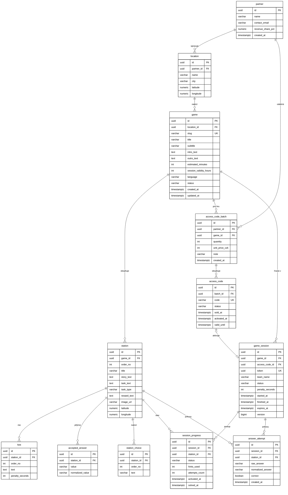
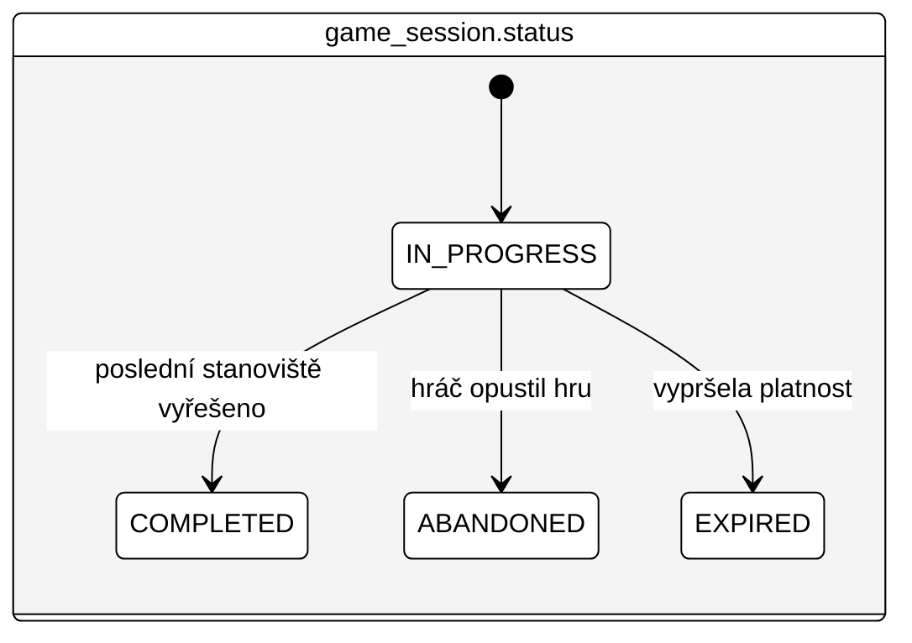
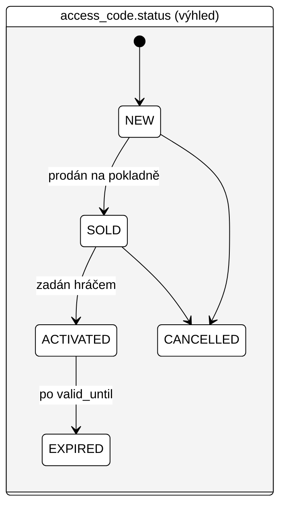

# 03 — Datový model

PostgreSQL 16+. Primární klíče `UUID` (`gen_random_uuid()`), časy `TIMESTAMPTZ`, enumy jako `VARCHAR` + `CHECK`. Názvy tabulek a sloupců anglicky, `snake_case`, jednotné číslo.

Model má tři oblasti:

- **Obsah** — partner, lokalita, hra, stanoviště, nápovědy, přijímané odpovědi, možnosti výběru
- **Prodej** — dávky přístupových kódů a kódy (v prototypu jen schéma, bez logiky)
- **Hraní** — herní relace, postup po stanovištích, pokusy o odpověď

## 1. ER diagram



## 2. Popis tabulek

### Obsah

| Tabulka | Účel | Poznámky |
|---|---|---|
| `partner` | Správa hradu/zámku — smluvní partner | `revenue_share_pct` = podíl partnera v % (výhled) |
| `location` | Konkrétní místo (hrad Loket + město) | GPS pro mapu a budoucí ověřování polohy |
| `game` | Jedna hra (příběh) | `slug` pro hezké URL; `status`: `DRAFT`, `PUBLISHED`, `ARCHIVED`; `language` zatím `cs` |
| `station` | Stanoviště hry | Unikátní `(game_id, order_no)`; `task_type`: `TEXT`, `NUMBER`, `CHOICE`; GPS a obrázek volitelné |
| `hint` | Nápovědy stanoviště v pořadí | Unikátní `(station_id, order_no)`; penalizace v sekundách |
| `accepted_answer` | Správné varianty odpovědi | `normalized_value` se vyplní aplikací (stejná normalizace jako u vstupu hráče) |
| `station_choice` | Nabízené možnosti pro `CHOICE` | Správná možnost je zároveň uložena v `accepted_answer` |

### Prodej (v prototypu bez logiky)

| Tabulka | Účel | Poznámky |
|---|---|---|
| `access_code_batch` | Vygenerovaná dávka kódů pro partnera a hru | Cena v celých Kč; poznámka např. „Sezóna 2027 — tisk 1“ |
| `access_code` | Jednotlivý kód | `status`: `NEW`, `SOLD`, `ACTIVATED`, `EXPIRED`, `CANCELLED`; `code` unikátní |

### Hraní

| Tabulka | Účel | Poznámky |
|---|---|---|
| `game_session` | Jedna rozehraná hra jednoho zařízení/týmu | `token` = identita hráče; `access_code_id` NULL v demo režimu; `version` pro optimistický zámek |
| `session_progress` | Stav stanoviště v rámci relace | Řádek vzniká při odemčení stanoviště; unikátní `(session_id, station_id)` |
| `answer_attempt` | Každý pokus o odpověď | Analytika obtížnosti; neukládá nic osobního |

## 3. Stavy





`session_progress.status`: `ACTIVE` → `SOLVED` (výhledově i `SKIPPED`).

## 4. DDL

Soubor `backend/src/main/resources/db/migration/V1__init_schema.sql`:

```sql
-- =========================================================
-- Obsah
-- =========================================================
CREATE TABLE partner (
    id                 UUID PRIMARY KEY DEFAULT gen_random_uuid(),
    name               VARCHAR(200) NOT NULL,
    contact_email      VARCHAR(200),
    revenue_share_pct  NUMERIC(5,2) CHECK (revenue_share_pct BETWEEN 0 AND 100),
    created_at         TIMESTAMPTZ  NOT NULL DEFAULT now()
);

CREATE TABLE location (
    id          UUID PRIMARY KEY DEFAULT gen_random_uuid(),
    partner_id  UUID         NOT NULL REFERENCES partner(id),
    name        VARCHAR(200) NOT NULL,
    city        VARCHAR(100),
    latitude    NUMERIC(9,6),
    longitude   NUMERIC(9,6)
);
CREATE INDEX ix_location_partner ON location(partner_id);

CREATE TABLE game (
    id                      UUID PRIMARY KEY DEFAULT gen_random_uuid(),
    location_id             UUID         NOT NULL REFERENCES location(id),
    slug                    VARCHAR(100) NOT NULL UNIQUE,
    title                   VARCHAR(200) NOT NULL,
    subtitle                VARCHAR(300),
    intro_text              TEXT         NOT NULL,
    outro_text              TEXT         NOT NULL,
    estimated_minutes       INT          CHECK (estimated_minutes > 0),
    session_validity_hours  INT          NOT NULL DEFAULT 24 CHECK (session_validity_hours > 0),
    language                VARCHAR(5)   NOT NULL DEFAULT 'cs',
    status                  VARCHAR(20)  NOT NULL DEFAULT 'DRAFT'
                            CHECK (status IN ('DRAFT','PUBLISHED','ARCHIVED')),
    created_at              TIMESTAMPTZ  NOT NULL DEFAULT now(),
    updated_at              TIMESTAMPTZ  NOT NULL DEFAULT now()
);
CREATE INDEX ix_game_location ON game(location_id);

CREATE TABLE station (
    id           UUID PRIMARY KEY DEFAULT gen_random_uuid(),
    game_id      UUID         NOT NULL REFERENCES game(id) ON DELETE CASCADE,
    order_no     INT          NOT NULL CHECK (order_no > 0),
    title        VARCHAR(200) NOT NULL,
    story_text   TEXT         NOT NULL,
    task_text    TEXT         NOT NULL,
    task_type    VARCHAR(20)  NOT NULL CHECK (task_type IN ('TEXT','NUMBER','CHOICE')),
    reward_text  TEXT         NOT NULL,
    image_url    VARCHAR(500),
    latitude     NUMERIC(9,6),
    longitude    NUMERIC(9,6),
    CONSTRAINT uq_station_game_order UNIQUE (game_id, order_no)
);

CREATE TABLE hint (
    id               UUID PRIMARY KEY DEFAULT gen_random_uuid(),
    station_id       UUID NOT NULL REFERENCES station(id) ON DELETE CASCADE,
    order_no         INT  NOT NULL CHECK (order_no > 0),
    text             TEXT NOT NULL,
    penalty_seconds  INT  NOT NULL DEFAULT 60 CHECK (penalty_seconds >= 0),
    CONSTRAINT uq_hint_station_order UNIQUE (station_id, order_no)
);

CREATE TABLE accepted_answer (
    id                UUID PRIMARY KEY DEFAULT gen_random_uuid(),
    station_id        UUID         NOT NULL REFERENCES station(id) ON DELETE CASCADE,
    value             VARCHAR(200) NOT NULL,
    normalized_value  VARCHAR(200) NOT NULL,
    CONSTRAINT uq_answer_station_value UNIQUE (station_id, normalized_value)
);

CREATE TABLE station_choice (
    id          UUID PRIMARY KEY DEFAULT gen_random_uuid(),
    station_id  UUID         NOT NULL REFERENCES station(id) ON DELETE CASCADE,
    order_no    INT          NOT NULL CHECK (order_no > 0),
    text        VARCHAR(200) NOT NULL,
    CONSTRAINT uq_choice_station_order UNIQUE (station_id, order_no)
);

-- =========================================================
-- Prodej (prototyp: jen schéma)
-- =========================================================
CREATE TABLE access_code_batch (
    id              UUID PRIMARY KEY DEFAULT gen_random_uuid(),
    partner_id      UUID         NOT NULL REFERENCES partner(id),
    game_id         UUID         NOT NULL REFERENCES game(id),
    quantity        INT          NOT NULL CHECK (quantity > 0),
    unit_price_czk  INT          CHECK (unit_price_czk >= 0),
    note            VARCHAR(300),
    created_at      TIMESTAMPTZ  NOT NULL DEFAULT now()
);
CREATE INDEX ix_batch_partner ON access_code_batch(partner_id);
CREATE INDEX ix_batch_game ON access_code_batch(game_id);

CREATE TABLE access_code (
    id            UUID PRIMARY KEY DEFAULT gen_random_uuid(),
    batch_id      UUID        NOT NULL REFERENCES access_code_batch(id),
    code          VARCHAR(20) NOT NULL UNIQUE,
    status        VARCHAR(20) NOT NULL DEFAULT 'NEW'
                  CHECK (status IN ('NEW','SOLD','ACTIVATED','EXPIRED','CANCELLED')),
    sold_at       TIMESTAMPTZ,
    activated_at  TIMESTAMPTZ,
    valid_until   TIMESTAMPTZ
);
CREATE INDEX ix_access_code_batch ON access_code(batch_id);

-- =========================================================
-- Hraní
-- =========================================================
CREATE TABLE game_session (
    id               UUID PRIMARY KEY DEFAULT gen_random_uuid(),
    game_id          UUID        NOT NULL REFERENCES game(id) ON DELETE CASCADE,
    access_code_id   UUID        UNIQUE REFERENCES access_code(id),
    token            UUID        NOT NULL UNIQUE,
    team_name        VARCHAR(100),
    status           VARCHAR(20) NOT NULL DEFAULT 'IN_PROGRESS'
                     CHECK (status IN ('IN_PROGRESS','COMPLETED','ABANDONED','EXPIRED')),
    penalty_seconds  INT         NOT NULL DEFAULT 0 CHECK (penalty_seconds >= 0),
    started_at       TIMESTAMPTZ NOT NULL DEFAULT now(),
    finished_at      TIMESTAMPTZ,
    expires_at       TIMESTAMPTZ NOT NULL,
    version          BIGINT      NOT NULL DEFAULT 0
);
CREATE INDEX ix_session_game ON game_session(game_id);

CREATE TABLE session_progress (
    id              UUID PRIMARY KEY DEFAULT gen_random_uuid(),
    session_id      UUID        NOT NULL REFERENCES game_session(id) ON DELETE CASCADE,
    station_id      UUID        NOT NULL REFERENCES station(id) ON DELETE CASCADE,
    status          VARCHAR(20) NOT NULL DEFAULT 'ACTIVE'
                    CHECK (status IN ('ACTIVE','SOLVED','SKIPPED')),
    hints_used      INT         NOT NULL DEFAULT 0 CHECK (hints_used >= 0),
    attempts_count  INT         NOT NULL DEFAULT 0 CHECK (attempts_count >= 0),
    activated_at    TIMESTAMPTZ NOT NULL DEFAULT now(),
    solved_at       TIMESTAMPTZ,
    CONSTRAINT uq_progress_session_station UNIQUE (session_id, station_id)
);

CREATE TABLE answer_attempt (
    id                 UUID PRIMARY KEY DEFAULT gen_random_uuid(),
    session_id         UUID         NOT NULL REFERENCES game_session(id) ON DELETE CASCADE,
    station_id         UUID         NOT NULL REFERENCES station(id) ON DELETE CASCADE,
    raw_answer         VARCHAR(200) NOT NULL,
    normalized_answer  VARCHAR(200) NOT NULL,
    correct            BOOLEAN      NOT NULL,
    created_at         TIMESTAMPTZ  NOT NULL DEFAULT now()
);
CREATE INDEX ix_attempt_session ON answer_attempt(session_id);
CREATE INDEX ix_attempt_station ON answer_attempt(station_id);
```

## 5. Migrace a seed

| Umístění | Soubor | Kdy běží |
|---|---|---|
| `db/migration` | `V1__init_schema.sql`, `V2__…` | Všechna prostředí |
| `db/seed` | `R__demo_game.sql` (repeatable) | Jen profil `dev` |

- Seed demo hry je **repeatable migrace** — spustí se znovu při každé změně obsahu souboru, takže herní texty lze ladit bez nových verzí schématu. Seed musí být idempotentní: nejprve smaže demo partnera/lokalitu/hru podle pevných UUID (kaskádně i stanoviště a relace), pak je vloží znovu.
- Pevná UUID v seedu (např. `00000000-0000-0000-0000-00000000000x`) usnadní testy a ladění.
- `accepted_answer.normalized_value` v seedu vyplnit ručně podle pravidel normalizace; integrační test ověří, že odpovídá výstupu `TextNormalizer` (zabrání rozjetí seedu a kódu).

## 6. Historie změn

| Verze | Změna |
|---|---|
| V1 | Počáteční schéma (obsah, prodej, hraní) |
