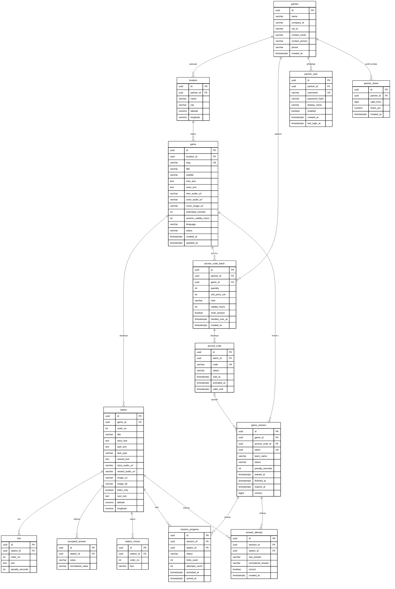
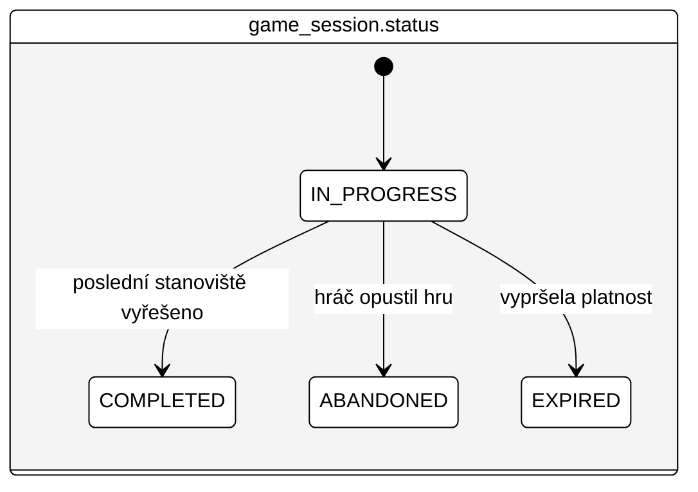
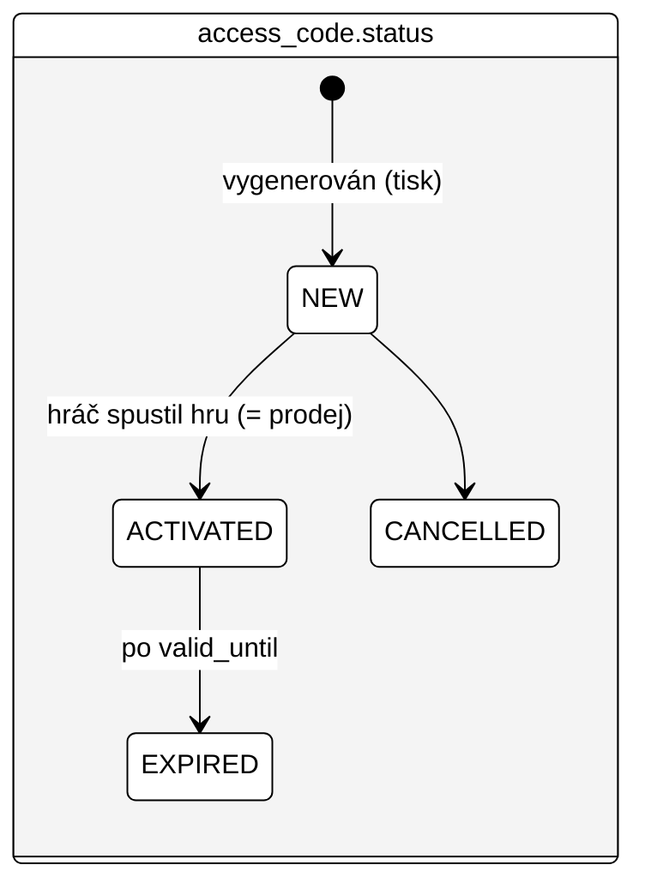

# 03 — Datový model

PostgreSQL 16+. Primární klíče `UUID` (`gen_random_uuid()`), časy `TIMESTAMPTZ`, enumy jako `VARCHAR` + `CHECK`. Názvy tabulek a sloupců anglicky, `snake_case`, jednotné číslo.

Model má tři oblasti:

- **Obsah** — partner, lokalita, hra, stanoviště, nápovědy, přijímané odpovědi, možnosti výběru
- **Prodej** — dávky přístupových kódů a kódy (v prototypu jen schéma, bez logiky)
- **Hraní** — herní relace, postup po stanovištích, pokusy o odpověď

## 1. ER diagram



## 2. Popis tabulek

### Obsah

| Tabulka | Účel | Poznámky |
|---|---|---|
| `partner` | Správa hradu/zámku — smluvní partner | Firemní údaje: `company_id` (IČ, 8 číslic, unikátní), `vat_id` (DIČ), `contact_person`, `contact_email`, `phone`; podíl na tržbě je v `partner_share` (od V5) |
| `partner_share` | Podíl partnera z tržby platný od data | `valid_from` (den podle Europe/Prague) — platí do dalšího záznamu; unikátní `(partner_id, valid_from)`; aktivovaný kód se vyúčtuje podle záznamu s nejvyšším `valid_from` ≤ den aktivace; budoucí datum = naplánovaná změna |
| `location` | Konkrétní místo (hrad Loket + město) | GPS pro mapu a budoucí ověřování polohy |
| `game` | Jedna hra (příběh) | `slug` pro hezké URL; `status`: `DRAFT`, `PUBLISHED`, `ARCHIVED`; `language` zatím `cs` |
| `station` | Stanoviště hry | Unikátní `(game_id, order_no)`; `task_type`: `TEXT`, `NUMBER`, `CHOICE`; GPS a obrázek volitelné |
| `hint` | Nápovědy stanoviště v pořadí | Unikátní `(station_id, order_no)`; penalizace v sekundách |
| `accepted_answer` | Správné varianty odpovědi | `normalized_value` se vyplní aplikací (stejná normalizace jako u vstupu hráče) |
| `station_choice` | Nabízené možnosti pro `CHOICE` | Správná možnost je zároveň uložena v `accepted_answer` |

### Prodej

| Tabulka | Účel | Poznámky |
|---|---|---|
| `access_code_batch` | Vygenerovaná dávka kódů pro partnera a hru (tisk na kartičky) | Cena v celých Kč; poznámka např. „Sezóna 2027 — tisk 1“; `validity_hours` = platnost kódu od aktivace (výchozí 5, `NULL` = bez expirace); `multi_session` = každé zadání kódu založí novou hru (vývojové kódy); `handed_over_at` = kdy byly vytištěné kartičky předány partnerovi — do té doby je dávka „ve výrobě“, její kódy nefungují a partner ji nevidí |
| `access_code` | Jednotlivý kód | `code` unikátní, uložený bez pomlčky (`ABCD2345`, tiskne se `ABCD-2345`); `status`: `NEW`, `ACTIVATED`, `EXPIRED`, `CANCELLED` (`SOLD` se nepoužívá — prodej = aktivace); `valid_until` = `activated_at + validity_hours` |

### Přístupy

| Tabulka | Účel | Poznámky |
|---|---|---|
| `partner_user` | Účet správy hradu do administrace (role `PARTNER`) — vidí jen data svého partnera | `username` unikátní, malými písmeny; `password_hash` BCrypt s prefixem `{bcrypt}`; `enabled = false` zablokuje přihlášení; účet správce aplikace (role `ADMIN`) je v konfiguraci, ne v DB |

### Hraní

| Tabulka | Účel | Poznámky |
|---|---|---|
| `game_session` | Jedna rozehraná hra jednoho týmu (může běžet na více zařízeních se stejným tokenem) | `token` = identita hráče; `access_code_id` = kód, kterým byla hra spuštěna (od V2 není unikátní: nová hra po opuštění nebo vývojový kód); `expires_at` nejpozději s platností kódu; `version` pro optimistický zámek |
| `session_progress` | Stav stanoviště v rámci relace | Řádek vzniká při odemčení stanoviště; unikátní `(session_id, station_id)` |
| `answer_attempt` | Každý pokus o odpověď | Analytika obtížnosti; neukládá nic osobního |

## 3. Stavy





`session_progress.status`: `ACTIVE` → `SOLVED` (výhledově i `SKIPPED`).

## 4. DDL

Výsledné schéma = V1 + V2 + V3 + V4 + V5 + V6 + V7 + V8 (V5 ruší `partner.revenue_share_pct` z V1 i `access_code_batch.revenue_share_pct` z V4).

### V1

Soubor `backend/src/main/resources/db/migration/V1__init_schema.sql`:

```sql
-- =========================================================
-- Obsah
-- =========================================================
CREATE TABLE partner (
    id                 UUID PRIMARY KEY DEFAULT gen_random_uuid(),
    name               VARCHAR(200) NOT NULL,
    contact_email      VARCHAR(200),
    revenue_share_pct  NUMERIC(5,2) CHECK (revenue_share_pct BETWEEN 0 AND 100),
    created_at         TIMESTAMPTZ  NOT NULL DEFAULT now()
);

CREATE TABLE location (
    id          UUID PRIMARY KEY DEFAULT gen_random_uuid(),
    partner_id  UUID         NOT NULL REFERENCES partner(id),
    name        VARCHAR(200) NOT NULL,
    city        VARCHAR(100),
    latitude    NUMERIC(9,6),
    longitude   NUMERIC(9,6)
);
CREATE INDEX ix_location_partner ON location(partner_id);

CREATE TABLE game (
    id                      UUID PRIMARY KEY DEFAULT gen_random_uuid(),
    location_id             UUID         NOT NULL REFERENCES location(id),
    slug                    VARCHAR(100) NOT NULL UNIQUE,
    title                   VARCHAR(200) NOT NULL,
    subtitle                VARCHAR(300),
    intro_text              TEXT         NOT NULL,
    outro_text              TEXT         NOT NULL,
    estimated_minutes       INT          CHECK (estimated_minutes > 0),
    session_validity_hours  INT          NOT NULL DEFAULT 24 CHECK (session_validity_hours > 0),
    language                VARCHAR(5)   NOT NULL DEFAULT 'cs',
    status                  VARCHAR(20)  NOT NULL DEFAULT 'DRAFT'
                            CHECK (status IN ('DRAFT','PUBLISHED','ARCHIVED')),
    created_at              TIMESTAMPTZ  NOT NULL DEFAULT now(),
    updated_at              TIMESTAMPTZ  NOT NULL DEFAULT now()
);
CREATE INDEX ix_game_location ON game(location_id);

CREATE TABLE station (
    id           UUID PRIMARY KEY DEFAULT gen_random_uuid(),
    game_id      UUID         NOT NULL REFERENCES game(id) ON DELETE CASCADE,
    order_no     INT          NOT NULL CHECK (order_no > 0),
    title        VARCHAR(200) NOT NULL,
    story_text   TEXT         NOT NULL,
    task_text    TEXT         NOT NULL,
    task_type    VARCHAR(20)  NOT NULL CHECK (task_type IN ('TEXT','NUMBER','CHOICE')),
    reward_text  TEXT         NOT NULL,
    image_url    VARCHAR(500),
    latitude     NUMERIC(9,6),
    longitude    NUMERIC(9,6),
    CONSTRAINT uq_station_game_order UNIQUE (game_id, order_no)
);

CREATE TABLE hint (
    id               UUID PRIMARY KEY DEFAULT gen_random_uuid(),
    station_id       UUID NOT NULL REFERENCES station(id) ON DELETE CASCADE,
    order_no         INT  NOT NULL CHECK (order_no > 0),
    text             TEXT NOT NULL,
    penalty_seconds  INT  NOT NULL DEFAULT 60 CHECK (penalty_seconds >= 0),
    CONSTRAINT uq_hint_station_order UNIQUE (station_id, order_no)
);

CREATE TABLE accepted_answer (
    id                UUID PRIMARY KEY DEFAULT gen_random_uuid(),
    station_id        UUID         NOT NULL REFERENCES station(id) ON DELETE CASCADE,
    value             VARCHAR(200) NOT NULL,
    normalized_value  VARCHAR(200) NOT NULL,
    CONSTRAINT uq_answer_station_value UNIQUE (station_id, normalized_value)
);

CREATE TABLE station_choice (
    id          UUID PRIMARY KEY DEFAULT gen_random_uuid(),
    station_id  UUID         NOT NULL REFERENCES station(id) ON DELETE CASCADE,
    order_no    INT          NOT NULL CHECK (order_no > 0),
    text        VARCHAR(200) NOT NULL,
    CONSTRAINT uq_choice_station_order UNIQUE (station_id, order_no)
);

-- =========================================================
-- Prodej (prototyp: jen schéma)
-- =========================================================
CREATE TABLE access_code_batch (
    id              UUID PRIMARY KEY DEFAULT gen_random_uuid(),
    partner_id      UUID         NOT NULL REFERENCES partner(id),
    game_id         UUID         NOT NULL REFERENCES game(id),
    quantity        INT          NOT NULL CHECK (quantity > 0),
    unit_price_czk  INT          CHECK (unit_price_czk >= 0),
    note            VARCHAR(300),
    created_at      TIMESTAMPTZ  NOT NULL DEFAULT now()
);
CREATE INDEX ix_batch_partner ON access_code_batch(partner_id);
CREATE INDEX ix_batch_game ON access_code_batch(game_id);

CREATE TABLE access_code (
    id            UUID PRIMARY KEY DEFAULT gen_random_uuid(),
    batch_id      UUID        NOT NULL REFERENCES access_code_batch(id),
    code          VARCHAR(20) NOT NULL UNIQUE,
    status        VARCHAR(20) NOT NULL DEFAULT 'NEW'
                  CHECK (status IN ('NEW','SOLD','ACTIVATED','EXPIRED','CANCELLED')),
    sold_at       TIMESTAMPTZ,
    activated_at  TIMESTAMPTZ,
    valid_until   TIMESTAMPTZ
);
CREATE INDEX ix_access_code_batch ON access_code(batch_id);

-- =========================================================
-- Hraní
-- =========================================================
CREATE TABLE game_session (
    id               UUID PRIMARY KEY DEFAULT gen_random_uuid(),
    game_id          UUID        NOT NULL REFERENCES game(id) ON DELETE CASCADE,
    access_code_id   UUID        UNIQUE REFERENCES access_code(id),
    token            UUID        NOT NULL UNIQUE,
    team_name        VARCHAR(100),
    status           VARCHAR(20) NOT NULL DEFAULT 'IN_PROGRESS'
                     CHECK (status IN ('IN_PROGRESS','COMPLETED','ABANDONED','EXPIRED')),
    penalty_seconds  INT         NOT NULL DEFAULT 0 CHECK (penalty_seconds >= 0),
    started_at       TIMESTAMPTZ NOT NULL DEFAULT now(),
    finished_at      TIMESTAMPTZ,
    expires_at       TIMESTAMPTZ NOT NULL,
    version          BIGINT      NOT NULL DEFAULT 0
);
CREATE INDEX ix_session_game ON game_session(game_id);

CREATE TABLE session_progress (
    id              UUID PRIMARY KEY DEFAULT gen_random_uuid(),
    session_id      UUID        NOT NULL REFERENCES game_session(id) ON DELETE CASCADE,
    station_id      UUID        NOT NULL REFERENCES station(id) ON DELETE CASCADE,
    status          VARCHAR(20) NOT NULL DEFAULT 'ACTIVE'
                    CHECK (status IN ('ACTIVE','SOLVED','SKIPPED')),
    hints_used      INT         NOT NULL DEFAULT 0 CHECK (hints_used >= 0),
    attempts_count  INT         NOT NULL DEFAULT 0 CHECK (attempts_count >= 0),
    activated_at    TIMESTAMPTZ NOT NULL DEFAULT now(),
    solved_at       TIMESTAMPTZ,
    CONSTRAINT uq_progress_session_station UNIQUE (session_id, station_id)
);

CREATE TABLE answer_attempt (
    id                 UUID PRIMARY KEY DEFAULT gen_random_uuid(),
    session_id         UUID         NOT NULL REFERENCES game_session(id) ON DELETE CASCADE,
    station_id         UUID         NOT NULL REFERENCES station(id) ON DELETE CASCADE,
    raw_answer         VARCHAR(200) NOT NULL,
    normalized_answer  VARCHAR(200) NOT NULL,
    correct            BOOLEAN      NOT NULL,
    created_at         TIMESTAMPTZ  NOT NULL DEFAULT now()
);
CREATE INDEX ix_attempt_session ON answer_attempt(session_id);
CREATE INDEX ix_attempt_station ON answer_attempt(station_id);
```

### V2

Soubor `backend/src/main/resources/db/migration/V2__access_code_activation.sql`:

```sql
-- =========================================================
-- Přístupové kódy: platnost od aktivace, vývojové kódy, více her na jeden kód
-- =========================================================

-- Platnost kódu v hodinách od aktivace (valid_until = activated_at + validity_hours).
-- NULL = kód nevyprší (vývojové kódy).
ALTER TABLE access_code_batch
    ADD COLUMN validity_hours INT DEFAULT 5 CHECK (validity_hours > 0);

-- Každé zadání kódu založí novou hru místo pokračování v té rozehrané (vývojové kódy pro opakované testování).
ALTER TABLE access_code_batch
    ADD COLUMN multi_session BOOLEAN NOT NULL DEFAULT FALSE;

-- Jeden kód může mít víc relací: vývojový kód, nebo nová hra po opuštění té předchozí během platnosti kódu.
ALTER TABLE game_session DROP CONSTRAINT game_session_access_code_id_key;
CREATE INDEX ix_session_access_code ON game_session(access_code_id);

-- Měsíční přehled aktivací pro fakturaci.
CREATE INDEX ix_access_code_activated_at ON access_code(activated_at);
```

### V3

Soubor `backend/src/main/resources/db/migration/V3__partner_user.sql`:

```sql
-- =========================================================
-- Účty partnerů (správa hradu) pro přehled aktivovaných kódů
-- Účet správce aplikace je v konfiguraci (ADMIN_USERNAME / ADMIN_PASSWORD), ne v DB.
-- =========================================================
CREATE TABLE partner_user (
    id             UUID PRIMARY KEY DEFAULT gen_random_uuid(),
    partner_id     UUID         NOT NULL REFERENCES partner(id) ON DELETE CASCADE,
    username       VARCHAR(100) NOT NULL UNIQUE,   -- malými písmeny
    password_hash  VARCHAR(200) NOT NULL,          -- {bcrypt}…, DelegatingPasswordEncoder
    display_name   VARCHAR(200),
    enabled        BOOLEAN      NOT NULL DEFAULT TRUE,
    created_at     TIMESTAMPTZ  NOT NULL DEFAULT now(),
    last_login_at  TIMESTAMPTZ
);
CREATE INDEX ix_partner_user_partner ON partner_user(partner_id);
```

### V4

Soubor `backend/src/main/resources/db/migration/V4__batch_revenue_share.sql`:

```sql
-- =========================================================
-- Podíl partnera zafixovaný na dávce kódů (jako cena za kód).
-- Změna partner.revenue_share_pct se tak projeví jen u nových dávek a nepřepíše
-- zpětně měsíční přehledy, podle kterých se už fakturovalo.
-- =========================================================
ALTER TABLE access_code_batch
    ADD COLUMN revenue_share_pct NUMERIC(5,2) CHECK (revenue_share_pct BETWEEN 0 AND 100);

UPDATE access_code_batch b
SET revenue_share_pct = p.revenue_share_pct
FROM partner p
WHERE p.id = b.partner_id;
```

### V5

Soubor `backend/src/main/resources/db/migration/V5__partner_share_history.sql`:

```sql
-- =========================================================
-- Podíl partnera s platností od data (historie podílů).
-- Aktivovaný kód se vyúčtuje podle podílu platného v den aktivace (Europe/Prague):
-- řádek s nejvyšším valid_from <= datum aktivace. Nahrazuje partner.revenue_share_pct
-- a podíl zafixovaný na dávce (V4).
-- =========================================================
CREATE TABLE partner_share (
    id          UUID PRIMARY KEY DEFAULT gen_random_uuid(),
    partner_id  UUID         NOT NULL REFERENCES partner(id) ON DELETE CASCADE,
    valid_from  DATE         NOT NULL,
    share_pct   NUMERIC(5,2) NOT NULL CHECK (share_pct BETWEEN 0 AND 100),
    created_at  TIMESTAMPTZ  NOT NULL DEFAULT now(),
    CONSTRAINT uq_partner_share_from UNIQUE (partner_id, valid_from)
);

-- Dosavadní podíl platí od založení partnera
INSERT INTO partner_share (partner_id, valid_from, share_pct)
SELECT id, (created_at AT TIME ZONE 'Europe/Prague')::date, revenue_share_pct
FROM partner
WHERE revenue_share_pct IS NOT NULL;

ALTER TABLE access_code_batch DROP COLUMN revenue_share_pct;
ALTER TABLE partner DROP COLUMN revenue_share_pct;
```

### V6

Soubor `backend/src/main/resources/db/migration/V6__partner_company_and_batch_handover.sql`:

```sql
-- =========================================================
-- Firemní údaje partnera a předání dávky kódů partnerovi
-- =========================================================
ALTER TABLE partner
    ADD COLUMN company_id     VARCHAR(20),    -- IČ
    ADD COLUMN vat_id         VARCHAR(20),    -- DIČ
    ADD COLUMN contact_person VARCHAR(200),
    ADD COLUMN phone          VARCHAR(50);
CREATE UNIQUE INDEX uq_partner_company_id ON partner(company_id) WHERE company_id IS NOT NULL;

-- Kódy dávky fungují až po předání partnerovi (do té doby jsou ve výrobě a nesmí jít použít).
ALTER TABLE access_code_batch ADD COLUMN handed_over_at TIMESTAMPTZ;

-- Dosavadní dávky už jsou v oběhu
UPDATE access_code_batch SET handed_over_at = created_at;
```

### V7

Soubor `backend/src/main/resources/db/migration/V7__audio.sql`:

```sql
-- =========================================================
-- Namluvené texty: odkaz na zvukový soubor (MP3) k textům hry.
-- NULL = text bez zvuku. Cesta je relativní k webu (např. /audio/demo/intro-vypravec.mp3).
-- =========================================================
ALTER TABLE game
    ADD COLUMN intro_audio_url VARCHAR(500),
    ADD COLUMN outro_audio_url VARCHAR(500);

ALTER TABLE station
    ADD COLUMN story_audio_url  VARCHAR(500),
    ADD COLUMN reward_audio_url VARCHAR(500);
```

### V8

Soubor `backend/src/main/resources/db/migration/V8__station_media_and_next_step.sql`:

```sql
-- =========================================================
-- Obrázky, poslechové úlohy a text „Kam dál“.
-- cover_image_url / image_url: cesta k obrázku na webu, NULL = bez obrázku (station.image_url je už z V1).
-- listen_only: příběh je úloha na poslech, text se zobrazí až na vyžádání (přepis).
-- next_text: rada vypravěče, kam má hráč jít po vyřešení kroku; zobrazí se pod odměnou.
-- =========================================================
ALTER TABLE game
    ADD COLUMN cover_image_url VARCHAR(500);

ALTER TABLE station
    ADD COLUMN image_alt   VARCHAR(300),
    ADD COLUMN listen_only BOOLEAN NOT NULL DEFAULT FALSE,
    ADD COLUMN next_text   TEXT;
```

## 5. Migrace a seed

| Umístění | Soubor | Kdy běží |
|---|---|---|
| `db/migration` | `V1__init_schema.sql`, `V2__…` | Všechna prostředí |
| `db/seed` | `R__demo_game.sql` (repeatable) — demo hra + vývojový kód `DEMO-KATA` (bez expirace, každé zadání = nová hra) + vývojový účet hradu `hrad` / `hrad-loket` | Jen profil `dev` |

- Seed demo hry je **repeatable migrace** — spustí se znovu při každé změně obsahu souboru, takže herní texty lze ladit bez nových verzí schématu. Seed musí být idempotentní: nejprve smaže demo partnera/lokalitu/hru podle pevných UUID (kaskádně i stanoviště a relace), pak je vloží znovu.
- Pevná UUID v seedu (např. `00000000-0000-0000-0000-00000000000x`) usnadní testy a ladění.
- `accepted_answer.normalized_value` v seedu vyplnit ručně podle pravidel normalizace; integrační test ověří, že odpovídá výstupu `TextNormalizer` (zabrání rozjetí seedu a kódu).

## 6. Historie změn

| Verze | Změna |
|---|---|
| V1 | Počáteční schéma (obsah, prodej, hraní) |
| V2 | Přístupové kódy: `access_code_batch.validity_hours`, `access_code_batch.multi_session`; zrušena unikátnost `game_session.access_code_id` (index `ix_session_access_code`); index `ix_access_code_activated_at` pro měsíční přehled |
| V3 | Tabulka `partner_user` — účty správy hradů pro přehled aktivací |
| V4 | `access_code_batch.revenue_share_pct` — podíl partnera zafixovaný na dávce (stávající dávky převzaly aktuální podíl partnera) |
| V5 | Podíl s platností od data: tabulka `partner_share` (dosavadní podíly převedeny jako platné od založení partnera); zrušeny `partner.revenue_share_pct` a `access_code_batch.revenue_share_pct` |
| V6 | Firemní údaje partnera (`company_id`, `vat_id`, `contact_person`, `phone`), `access_code_batch.handed_over_at` — kódy fungují až po předání (stávající dávky převedeny jako předané) |
| V7 | Namluvené texty: `game.intro_audio_url`, `game.outro_audio_url`, `station.story_audio_url`, `station.reward_audio_url` (cesta k MP3, NULL = jen text) |
| V8 | Obrázky a vedení hráče: `game.cover_image_url`, `station.image_alt` (k `image_url` z V1), `station.listen_only` (poslechová úloha), `station.next_text` (kam jít dál) |
