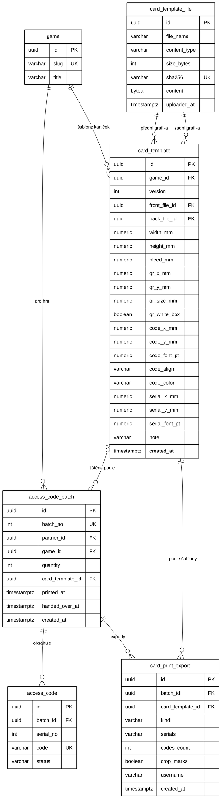

# 07 — Tisk kartiček (generátor tiskových PDF)

Generátor tiskových podkladů pro kartičky s přístupovými kódy. Je součástí administrace (role `ADMIN`) a běží na serveru ve stávající aplikaci. Samostatná aplikace pro PC se nedělá: generování je nenáročné a kódy už jsou v DB.

**Stav (2026-11-03):** implementováno (migrace V20, balíček `cardprint`, editor šablony a stránka tisku v administraci). Zbývá ověření na stagingu a ruční tisk, viz kap. 11. Oproti původnímu návrhu: migrace má číslo **V20** (V12 už byla obsazená), grafika se nahrává samostatně a šablona na ni odkazuje (kap. 6), písmo je Liberation Sans přibalené v PDFBox (kap. 5.2).

## 1. Cíl a rozsah

- Ze **dávky kódů** (`access_code_batch`) vznikají dvě tisková PDF:
  - **přední strana:** 1 stránka, protože je pro všechny kartičky stejná,
  - **zadní strana:** co kód, to stránka (100 kódů = 100 stránek); obsahuje QR kód a vytištěný kód.
- Grafika přední a zadní strany a rozmístění QR a kódu se ukládají jako **šablona hry**. Při dalších dávkách stejné hry se použije automaticky.
- Šablona je verzovaná. Dávka si pamatuje verzi, se kterou se tiskla, takže dotisk vypadá stejně i po změně grafiky.

**Ano:** šablona hry s verzemi, náhled karty, přední a zadní PDF, ZIP s oběma PDF a CSV, dotisk vybraných kódů, testovací tisk A4, ořezové značky jako volba, pořadové číslo na kartě, audit exportů.

**Ne (zatím):** vyřazení více karet na arch (impozice), nahrání CSV jako zdroje (viz kap. 9), vlastní fonty ze šablony, generování na pozadí.

### Rozhodnutí

| Téma | Rozhodnutí | Důvod |
|---|---|---|
| Rozměr kartičky | Klasická vizitka **90 × 50 mm** (výchozí), alternativně evropská 85 × 55 mm; na šířku i na výšku; výchozí spadávka **2 mm** (rozhodnuto 2026-11-03; sloupec `bleed_mm` má v DB výchozí 3, aplikace ho ale vždy vyplní) | Formát, na který jsou tiskárny připravené (papír, řezání, ceník); pro QR a kód místa dost |
| Kde běží | Na serveru, v administraci | 100 karet se vygeneruje pod sekundu, 5 000 karet (max. dávka) za jednotky sekund; paměť v desítkách MB |
| Zdroj kódů | Dávka z DB, ne nahrané CSV | Partner i hra jsou u dávky známé; žádné riziko špatného nebo upraveného souboru |
| Úložiště grafiky | PostgreSQL `BYTEA` | Zálohuje se spolu s DB (`pg_dump`), žádný další volume ani cesty na disku |
| Vygenerovaná PDF | Neukládají se, generují se na vyžádání | Výstup je deterministický (šablona + kódy); na serveru neleží soubory s platnými kódy |
| Knihovny | Apache PDFBox 3.0.5, ZXing `core` 3.5.3 | Obě licence Apache 2.0; PDFBox umí vložit PDF stránku jako vektor a znovu použít grafiku |

## 2. Flow v administraci

1. **Detail hradu → Kódy a předání → řádek dávky → „Tisk“.** Otevře se stránka tisku dávky (`/admin/batches/:id/tisk`).
2. **Šablona.**
   - Hra šablonu nemá → průvodce vytvořením šablony (kap. 4).
   - Hra šablonu má → zobrazí se poslední verze s náhledem. Lze ji upravit, čímž vznikne nová verze.
   - Dávka už je k verzi přivázaná (byla tištěná) → použije se ta. Dokud je dávka **ve výrobě** (`handed_over_at IS NULL`), lze ji přivázat k jiné verzi; po předání už ne.
3. **Náhled** přední a zadní strany s prvním kódem dávky.
4. **Stažení:**
   - `Přední strana (PDF)`
   - `Zadní strana (PDF, N stran)`
   - `Vše (ZIP)`: obě PDF + `codes.csv`
   - `Dotisk…`: výběr pořadových čísel (`42, 57, 100–110`) → zadní PDF jen s nimi
   - zaškrtávátko `Ořezové značky`
5. **Testovací tisk A4** (u šablony): jedna karta z obou stran ve skutečné velikosti pro kontrolu měřítka a čitelnosti QR.

V seznamu dávek je sloupec **Dávka** (`D12`) a **Tisk**: „netištěno“ nebo datum prvního exportu zadní strany (`printed_at`) a verze šablony. Odkaz „CSV pro tisk“ se přejmenoval na „CSV kódů“ (zůstává pro tiskárny, které si data sázejí samy).

## 3. Datový model

Migrace `V20__card_print.sql`. Nové tabulky `card_template_file`, `card_template`, `card_print_export`; nové sloupce `access_code_batch.batch_no`, `access_code_batch.card_template_id`, `access_code_batch.printed_at`, `access_code.serial_no`.

### 3.1 ER diagram (část pro tisk)

Úplný diagram v `docs/03-datovy-model.md` je potřeba doplnit o tyto tabulky a vazby.



### 3.2 Popis

| Tabulka / sloupec | Účel | Poznámky |
|---|---|---|
| `card_template_file` | Nahraný soubor grafiky (PDF, PNG, JPG) | `sha256` unikátní: stejný soubor se uloží jednou a sdílí ho víc verzí (změna jen pozic nevytváří kopii grafiky). Obsah se načítá jen při generování, nikdy v seznamech |
| `card_template` | Verze šablony kartičky hry | Unikátní `(game_id, version)`; platná je nejvyšší verze. Úprava = nový řádek, stávající se nemění. Rozměry v mm, písmo v pt. Souřadnice jsou od **levého horního rohu ořezu** (hotové kartičky), ne od okraje se spadávkou |
| `qr_*` | Pozice a velikost QR | `qr_x_mm`, `qr_y_mm` = levý horní roh čtverce; `qr_size_mm` = celý čtverec **včetně bílého okraje** (quiet zone 4 moduly), min. 18 mm; `qr_white_box` = pod QR se kreslí bílý čtverec (nutné na tmavém nebo strukturovaném pozadí) |
| `code_*` | Vytištěný kód `ABCD-2345` | `code_x_mm`, `code_y_mm` = bod na účaří podle zarovnání `code_align` (`LEFT`/`CENTER`/`RIGHT`); `code_color` `#RRGGBB` |
| `serial_*` | Pořadové číslo `D12 · 0042` | Všechny tři `NULL` = nezobrazuje se |
| `access_code_batch.batch_no` | Krátké lidské číslo dávky (`D12`) | Identity, stávající dávky očíslované podle `created_at` |
| `access_code_batch.card_template_id` | Verze šablony, podle které se dávka tiskne | Přiváže se při prvním exportu; změna jen dokud je dávka ve výrobě |
| `access_code_batch.printed_at` | Kdy se poprvé exportovala zadní strana | Jen informativní (sloupec Tisk v seznamu) |
| `access_code.serial_no` | Pořadí kódu v dávce 1…N | Unikátní `(batch_id, serial_no)`; tiskne se na kartu, slouží pro dotisk a dohledání karty. Stávající kódy očíslované podle `code`; aplikace přiděluje 1…N při vytvoření dávky, kód vložený přímo v SQL (seed, testy, ruční oprava) dostane další číslo v dávce triggerem `tg_access_code_serial` |
| `card_print_export` | Audit stažení | `kind`: `FRONT`, `BACK`, `ZIP`; `serials` = výběr pro dotisk (`42,57,100-110`), `NULL` = celá dávka; `username` = kdo stáhl |

### 3.3 DDL

Soubor `backend/src/main/resources/db/migration/V20__card_print.sql`:

```sql
-- =========================================================
-- Tisk kartiček s přístupovými kódy (docs/07-tisk-karticek.md).
-- Šablona kartičky hry je verzovaná: úprava = nový řádek, vytištěná dávka si drží svou verzi.
-- Grafika je v DB (záloha spolu s DB), stejný soubor se uloží jednou (sha256) a sdílí ho víc verzí.
-- =========================================================
CREATE TABLE card_template_file (
    id            UUID PRIMARY KEY DEFAULT gen_random_uuid(),
    file_name     VARCHAR(255) NOT NULL,
    content_type  VARCHAR(100) NOT NULL
                  CHECK (content_type IN ('application/pdf','image/png','image/jpeg')),
    size_bytes    INT          NOT NULL CHECK (size_bytes > 0),
    sha256        VARCHAR(64)  NOT NULL UNIQUE,
    content       BYTEA        NOT NULL,
    uploaded_at   TIMESTAMPTZ  NOT NULL DEFAULT now()
);

CREATE TABLE card_template (
    id              UUID PRIMARY KEY DEFAULT gen_random_uuid(),
    game_id         UUID         NOT NULL REFERENCES game(id) ON DELETE CASCADE,
    version         INT          NOT NULL CHECK (version > 0),
    front_file_id   UUID         NOT NULL REFERENCES card_template_file(id),
    back_file_id    UUID         NOT NULL REFERENCES card_template_file(id),
    -- ořez (hotová kartička) a spadávka v mm; výchozí = vizitka 90 × 50 mm na šířku
    width_mm        NUMERIC(6,2) NOT NULL DEFAULT 90 CHECK (width_mm BETWEEN 30 AND 300),
    height_mm       NUMERIC(6,2) NOT NULL DEFAULT 50 CHECK (height_mm BETWEEN 30 AND 300),
    bleed_mm        NUMERIC(4,2) NOT NULL DEFAULT 3 CHECK (bleed_mm BETWEEN 0 AND 10),
    -- pozice se měří od levého horního rohu ořezu
    qr_x_mm         NUMERIC(6,2) NOT NULL,
    qr_y_mm         NUMERIC(6,2) NOT NULL,
    qr_size_mm      NUMERIC(6,2) NOT NULL CHECK (qr_size_mm >= 18),   -- včetně bílého okraje (quiet zone)
    qr_white_box    BOOLEAN      NOT NULL DEFAULT TRUE,
    code_x_mm       NUMERIC(6,2) NOT NULL,
    code_y_mm       NUMERIC(6,2) NOT NULL,                             -- účaří
    code_font_pt    NUMERIC(4,1) NOT NULL DEFAULT 12 CHECK (code_font_pt BETWEEN 6 AND 48),
    code_align      VARCHAR(6)   NOT NULL DEFAULT 'CENTER'
                    CHECK (code_align IN ('LEFT','CENTER','RIGHT')),
    code_color      VARCHAR(7)   NOT NULL DEFAULT '#000000' CHECK (code_color ~ '^#[0-9A-Fa-f]{6}$'),
    serial_x_mm     NUMERIC(6,2),
    serial_y_mm     NUMERIC(6,2),
    serial_font_pt  NUMERIC(4,1) CHECK (serial_font_pt BETWEEN 4 AND 24),
    note            VARCHAR(300),
    created_at      TIMESTAMPTZ  NOT NULL DEFAULT now(),
    CONSTRAINT uq_card_template_game_version UNIQUE (game_id, version),
    CONSTRAINT ck_card_template_serial CHECK (
        (serial_x_mm IS NULL AND serial_y_mm IS NULL AND serial_font_pt IS NULL)
        OR (serial_x_mm IS NOT NULL AND serial_y_mm IS NOT NULL AND serial_font_pt IS NOT NULL))
);

-- Krátké lidské číslo dávky (D12), stávající dávky očíslované podle vytvoření
ALTER TABLE access_code_batch ADD COLUMN batch_no INT;
UPDATE access_code_batch b SET batch_no = n.rn
FROM (SELECT id, ROW_NUMBER() OVER (ORDER BY created_at, id) AS rn FROM access_code_batch) n
WHERE n.id = b.id;
ALTER TABLE access_code_batch ALTER COLUMN batch_no SET NOT NULL;
ALTER TABLE access_code_batch ALTER COLUMN batch_no ADD GENERATED BY DEFAULT AS IDENTITY;
SELECT setval(pg_get_serial_sequence('access_code_batch', 'batch_no'),
              COALESCE((SELECT MAX(batch_no) FROM access_code_batch), 0) + 1, false);
ALTER TABLE access_code_batch ADD CONSTRAINT uq_batch_no UNIQUE (batch_no);

ALTER TABLE access_code_batch
    ADD COLUMN card_template_id UUID REFERENCES card_template(id),
    ADD COLUMN printed_at       TIMESTAMPTZ;

-- Pořadí kódu v dávce (1…N), tiskne se na kartičku; stávající kódy očíslované podle kódu
ALTER TABLE access_code ADD COLUMN serial_no INT;
UPDATE access_code c SET serial_no = n.rn
FROM (SELECT id, ROW_NUMBER() OVER (PARTITION BY batch_id ORDER BY code) AS rn FROM access_code) n
WHERE n.id = c.id;
ALTER TABLE access_code ALTER COLUMN serial_no SET NOT NULL;
ALTER TABLE access_code ADD CONSTRAINT uq_access_code_batch_serial UNIQUE (batch_id, serial_no);

-- Aplikace pořadí přiděluje sama; kód vložený přímo v SQL (seed, ruční oprava) dostane další číslo v dávce
CREATE FUNCTION access_code_next_serial() RETURNS trigger LANGUAGE plpgsql AS $$
BEGIN
    IF NEW.serial_no IS NULL THEN
        SELECT COALESCE(MAX(serial_no), 0) + 1 INTO NEW.serial_no FROM access_code WHERE batch_id = NEW.batch_id;
    END IF;
    RETURN NEW;
END
$$;
CREATE TRIGGER tg_access_code_serial BEFORE INSERT ON access_code
    FOR EACH ROW EXECUTE FUNCTION access_code_next_serial();

-- Audit stažení tiskových podkladů (PDF obsahují kódy, které po předání platí)
CREATE TABLE card_print_export (
    id                UUID PRIMARY KEY DEFAULT gen_random_uuid(),
    batch_id          UUID         NOT NULL REFERENCES access_code_batch(id) ON DELETE CASCADE,
    card_template_id  UUID         NOT NULL REFERENCES card_template(id),
    kind              VARCHAR(10)  NOT NULL CHECK (kind IN ('FRONT','BACK','ZIP')),
    serials           VARCHAR(1000),           -- výběr pro dotisk, NULL = celá dávka
    codes_count       INT          NOT NULL CHECK (codes_count >= 0),
    crop_marks        BOOLEAN      NOT NULL DEFAULT FALSE,
    username          VARCHAR(100) NOT NULL,
    created_at        TIMESTAMPTZ  NOT NULL DEFAULT now()
);
CREATE INDEX ix_print_export_batch ON card_print_export(batch_id);
```

Poznámky:

- `AccessCodeAdminService` přiděluje `serial_no` 1…N při vytvoření dávky.
- `sha256` je `VARCHAR(64)` (ne `CHAR`), aby sedělo s validací schématu v Hibernate.
- Unikátní index na `access_code_batch.uq_batch_no` vzniká až po doplnění hodnot.
- `card_template_file` se nemaže kaskádně, sdílí ho víc verzí. Úklid osiřelých souborů není potřeba.
- Ověřit migraci na kopii stagingu, včetně `setval` u identity.

## 4. Šablona kartičky

### 4.1 Editor (`/admin/games/:id/karticka`)

- **Rozměr:** `Vizitka 90 × 50 mm` (výchozí) nebo `Eurovizitka 85 × 55 mm`, orientace na šířku / na výšku (prohodí šířku a výšku); spadávka (výchozí 2 mm, upravit podle tiskárny). Jiné rozměry UI nenabízí, DB je ale nevylučuje.
- **Výchozí rozložení zadní strany** (vizitka 90 × 50 mm na šířku), předvyplněné u první verze šablony:

  | Prvek | Pozice | Velikost |
  |---|---|---|
  | QR (včetně bílého okraje) | x 5 mm, y 6 mm (vlevo nahoře) | 30 mm, modul cca 0,8 mm |
  | Kód `ABCD-2345` | x 60 mm, y 32 mm, na střed | 16 pt |
  | Pořadové číslo | x 60 mm, y 37,5 mm, na střed | 6 pt |

  Rozložení odpovídá grafice zadní strany z `grafika/karticky/karticky-prompty.md`: grafika nese vpravo nahoře dva kroky („Naskenuj QR kód“, „Hraj“), pod nimi světlé pole pro kód a dole tmavý pruh s adresou **www.storyhold.cz** pro ruční zadání kódu (y 41–50 mm). Vše leží v bezpečné zóně 3 mm od ořezu. Eurovizitka na šířku má stejné pozice (kód na střed mezi QR a pravým okrajem), na výšku je QR nahoře a kód pod ním.
- **Grafika přední a zadní strany:** nahrání souboru; u nové verze lze ponechat soubor z předchozí verze.
- **QR:** x, y, velikost, bílý podklad.
- **Kód:** x, y, velikost písma, zarovnání, barva.
- **Pořadové číslo:** zapnout/vypnout, x, y, velikost.
- **Živý náhled** zadní strany (debounce cca 400 ms) s ukázkovým kódem, včetně vyznačení ořezu, spadávky a bezpečné zóny.
- **Uložit** → nová verze. Upozornění, pokud jsou ve výrobě dávky přivázané ke starší verzi (lze je přepnout na stránce tisku).

### 4.2 Požadavky na grafiku a validace při nahrání

| Vstup | Požadavek | Kontrola |
|---|---|---|
| **PDF** (doporučeno, od grafika) | 1 strana o rozměru ořez + 2 × spadávka | Velikost stránky ±0,5 mm, jinak `400` s očekávaným rozměrem; víc stran → použije se první s upozorněním; šifrované PDF → `400` |
| **PNG / JPG** | Poměr stran jako ořez + spadávka, ≥ 300 DPI | Poměr ±1 %, jinak `400`; DPI = šířka v px / šířka v palcích, pod 300 → upozornění (ne chyba); CMYK JPEG se vloží beze změny |
| Velikost souboru | max. 20 MB | `spring.servlet.multipart.max-file-size` |

Při uložení šablony se navíc kontroluje (jako **upozornění**, ne chyba), že QR, kód i pořadové číslo leží v ořezu aspoň 3 mm od okraje (bezpečná zóna).

## 5. Generování PDF

### 5.1 Komponenty

Nový balíček `cardprint`:

```
cardprint/
├── domain/                  # CardTemplate, CardTemplateFile, CardPrintExport
├── CardTemplateService      # verze, nahrání a validace grafiky, deduplikace podle sha256
├── CardTemplateAdminController
├── CardPdfRenderer          # čistá třída bez DB: šablona + grafika + seznam kódů → OutputStream
├── CardPrintService         # výběr kódů, přivázání šablony, audit, omezení souběhu
├── CardPrintAdminController
└── SerialSelection          # parsování "42, 57, 100-110"
```

### 5.2 Renderer

- **Rozměr stránky** = ořez + 2 × spadávka (s ořezovými značkami navíc 2 × 8 mm). Převod `mm → pt` = `mm × 72 / 25,4`. Souřadnice ze šablony (od levého horního rohu ořezu) se převádějí na PDF souřadnice (od levého dolního rohu stránky).
- **Grafika se do dokumentu vloží jednou** a každá stránka na ni odkazuje:
  - PDF: `LayerUtility.importPageAsForm(...)` → `PDFormXObject`, zůstává vektorová,
  - PNG/JPG: `PDImageXObject.createFromByteArray(...)`.
  - Velikost zadního PDF je tak přibližně velikost grafiky + jednotky kB na stránku.
- **QR:** ZXing `QRCodeWriter`, korekce chyb `M`, okraj 4 moduly. Obsah = odkaz jako v CSV: `<PUBLIC_URL>/?kod=ABCD-2345`. Kreslí se **vektorově**: souvislé běhy tmavých modulů v řádku jako jeden obdélník (méně operací v PDF). Pod QR volitelně bílý čtverec přes celou velikost.
- **Barvy:** černá (QR i text `#000000`) jako čistá černá CMYK `0/0/0/100`, aby při tisku nevznikal soutisk. Ostatní barvy textu RGB.
- **Font:** Liberation Sans Regular (licence SIL OFL), který je přibalený v PDFBox; vlastní soubor fontu v repozitáři tedy není. Abeceda kódů nemá snadno zaměnitelné znaky (bez 0/O, 1/I/L), bezpatkové písmo stačí. Načte se jednou na dokument přes `PDType0Font.load(...)` (vloží se jen použité znaky). Náhled se renderuje až z uloženého PDF, kdy je podmnožina fontu vložená (jinak by PDFBox hledal systémové fonty).
- **Kód** se tiskne s pomlčkou (`ABCD-2345`), **pořadové číslo** jako `D{batch_no} · {serial_no 4 číslice}`.
- **Ořezové značky** (volba exportu): čáry 0,25 pt, délka 5 mm, odsazené 3 mm od ořezu, mimo spadávku.
- **Paměť:** `new PDDocument(IOUtils.createTempFileOnlyStreamCache())`; výstup se zapíše do dočasného souboru, pak se pošle klientovi s `Content-Length` a soubor se smaže. Při chybě se tak neodešle polovina PDF.

### 5.3 Výkon a souběh

- Odhad: 100 karet pod 1 s, 5 000 karet (max. dávka) jednotky sekund, paměť v desítkách MB. Ověřit testem na stagingu.
- Generuje se synchronně v požadavku. `CardPrintService` drží `Semaphore(1)`: souběžné generování čeká max. 30 s, pak `503` s hláškou „Právě se generuje jiný tisk, zkuste to za chvíli.“
- Náhled (PNG) se renderuje přes `PDFRenderer` ve 150 DPI a vrací se jako data URL v JSON spolu s upozorněními. Náhledy se semaforem neomezují (jedna strana, desítky ms).
- **Docker:** renderování náhledu používá AWT v headless režimu. Runtime image proto preventivně instaluje `fontconfig` a `ttf-dejavu` (`Dockerfile`); ověřit na stagingu.

### 5.4 Testovací tisk A4

Jedna stránka A4: přední a zadní strana vedle sebe ve skutečné velikosti s ořezovými značkami, měřítko 50 mm pro kontrolu tisku 100 % a text „Tiskněte v měřítku 100 %“. Kód je náhodně vygenerovaný ve správném formátu a **neukládá se do DB**: po načtení QR se otevře aplikace s hláškou o neplatném kódu, což stačí k ověření, že QR jde přečíst a vede na správnou adresu.

## 6. REST API (`/api/v1/admin/**`, role `ADMIN`)

Exporty a náhledy jsou `POST` (zapisují audit, přivazují šablonu, CSRF jako ostatní administrace). Frontend stáhne odpověď jako blob a nabídne ji k uložení.

| Metoda | Cesta | Popis |
|---|---|---|
| POST | `/admin/card-template-files` | Nahrání grafiky jedné strany: multipart `file` (PDF/PNG/JPG podle obsahu, max. 20 MB; zabezpečené PDF → `400`) → `201` `{ id, fileName, contentType, sizeBytes }`; stejný obsah (`sha256`) vrátí existující soubor. Rozměr se kontroluje až proti šabloně (při náhledu a uložení) |
| GET | `/admin/games/{gameId}/card-template` | Poslední verze šablony (metadata, bez souborů) → `200` / `404` |
| GET | `/admin/games/{gameId}/card-template/versions` | Seznam verzí (`version`, `createdAt`, `note`, počet dávek, které ji používají) |
| POST | `/admin/games/{gameId}/card-template` | Nová verze: JSON `{ layout, frontFileId, backFileId, note }` (`layout` = rozměry a pozice, viz `CardLayout`); chybějící soubor se převezme z předchozí verze (u první verze povinné). Grafika jiného rozměru → `400` s očekávaným rozměrem → `201` `{ template, warnings[] }` (nízké DPI, víc stran PDF, bezpečná zóna, dávky ve výrobě podle starší verze). Jazyková verze hry → `400` (kartičky má hlavní hra) |
| POST | `/admin/games/{gameId}/card-template/preview?side=FRONT\|BACK` | Náhled neuloženého stavu editoru (stejné tělo jako uložení, grafika může chybět = bílá karta) → `{ image: "data:image/png;base64,…", warnings[] }`; chyby rozměru grafiky jsou tu jen upozornění |
| GET | `/admin/card-templates/{id}/files/{FRONT\|BACK}` | Původní nahraný soubor ke stažení |
| GET | `/admin/card-templates/{id}/test-print.pdf` | Testovací tisk A4 (kap. 5.4); bez kódů z DB, proto `GET` a bez auditu |
| GET | `/admin/batches/{id}/print` | Stav tisku dávky: přivázaná verze, poslední verze hry, `printedAt`, poslední exporty |
| POST | `/admin/batches/{id}/print/template` | `{ "templateId" }` přiváže dávku k verzi; po předání dávky `409` |
| POST | `/admin/batches/{id}/print/preview?side=FRONT\|BACK` | Náhled karty s prvním kódem dávky (bez auditu a přivázání) → `{ image, warnings }` |
| POST | `/admin/batches/{id}/print/front.pdf` | `{ "cropMarks" }` (chybí = bez značek) → `application/pdf` |
| POST | `/admin/batches/{id}/print/back.pdf` | `{ "cropMarks", "serials" }`; `serials` = `"42, 57, 100-110"`, `null` = celá dávka; neexistující číslo → `400` |
| POST | `/admin/batches/{id}/print/all.zip` | `{ "cropMarks" }` → ZIP s oběma PDF a `codes.csv` (stejné jako `/codes.csv`, navíc sloupec `poradi`) |

Společná pravidla exportů:

- Dávka bez přivázané šablony se při prvním exportu přiváže k **poslední verzi** šablony hry; hra bez šablony → `409` „Hra nemá šablonu kartičky“.
- Souběžné generování čeká nejvýš 30 s, pak `503` s typem `print-busy`.
- Export zadní strany nebo ZIPu nastaví `printed_at`, pokud je prázdné.
- Každý export zapíše řádek do `card_print_export`.
- Hlavičky: `Cache-Control: no-store`, `Content-Disposition: attachment`.
- Názvy souborů: `storyhold_{slug}_D{batchNo}_predni.pdf`, `storyhold_{slug}_D{batchNo}_zadni_{N}ks.pdf`, `storyhold_{slug}_D{batchNo}.zip`; u dotisku `…_dotisk_{N}ks.pdf`.
- Export po předání dávky je povolený (dotisk), UI ale upozorní, že kódy v PDF jsou už platné.
- **Demo dávka** (sdílený kód, `multi_session`) má jeden kód; `copies` určí, na kolik kartiček se vytiskne (zadní PDF má tolik stran, všechny se stejným kódem). Dotisk vybraných čísel u ní není. **Dávka zdarma** se tiskne jako prodejní.

## 7. Bezpečnost

- Zadní PDF obsahuje přístupové kódy, tedy peníze. Generování smí jen `ADMIN`; partner (`PARTNER`) k tisku přístup nemá.
- Dokud je dávka **ve výrobě**, kódy nefungují. Únik PDF před předáním tedy nic nestojí, po předání ano.
- PDF se na serveru neukládají; dočasné soubory se mažou hned po odeslání.
- Audit `card_print_export`: kdo, kdy, co a kolik kódů.

## 8. Testy

- **Renderer (unit, bez DB):**
  - počet stran zadního PDF = počet kódů; přední PDF má 1 stranu,
  - `MediaBox` = ořez + 2 × spadávka, pro vizitku se spadávkou 2 mm tedy 94 × 54 mm (s ořezovými značkami + 2 × 8 mm),
  - výchozí rozložení vizitky leží celé v bezpečné zóně,
  - vyrenderovaná stránka (`PDFRenderer`, 300 DPI) jde dekódovat ZXingem a obsah QR = očekávaný odkaz s kódem,
  - grafika je v dokumentu jednou: zadní PDF pro 100 kódů je menší než velikost grafiky + 100 × 10 kB,
  - vstupní PDF grafika zůstává vektorová (form XObject, ne obrázek).
- **SerialSelection:** `"42, 57, 100-110"`, mezery, opačné rozsahy, duplicity, mimo dávku → chyba.
- **Integrační (Testcontainers):** migrace V20 na DB se stávajícími dávkami (`batch_no`, `serial_no` doplněné, unikátní), verzování šablony, deduplikace souborů podle `sha256`, přivázání šablony a `409` po předání, audit, `printed_at`, `403` pro roli `PARTNER`.
- **Ruční:** testovací tisk A4 na obyčejné tiskárně, načtení QR iPhonem i Androidem, kontrola rozměru pravítkem.

## 9. Mimo rozsah a možná rozšíření

- **Nahrání CSV jako zdroje kódů:** nahrazeno výběrem dávky. Kdyby bylo potřeba (např. kódy vzniklé mimo aplikaci), CSV by se jen spárovalo s kódy v DB a nepárové řádky by se odmítly.
- **Impozice** (víc vizitek na arch SRA3) s ořezovými značkami, pokud ji tiskárna bude chtít. U vizitek si vyřazení na arch tiskárny obvykle dělají samy.
- **Generování na pozadí** s notifikací, kdyby dávky výrazně přerostly 5 000 kusů.
- **Jazykové mutace** kartiček (návaznost na UC-17): šablona by dostala jazyk.
- **Vlastní font** nahraný do šablony.

## 10. Otevřené otázky pro tiskárnu

1. Potvrdit vizitku 90 × 50 mm (případně 85 × 55 mm); zaoblené rohy, gramáž a povrch (lamino zhoršuje čitelnost QR odlesky, matné je bezpečnější).
2. Spadávka (u vizitek tiskárny chtějí obvykle 2–3 mm) a zda chtějí ořezové značky.
3. RGB, nebo CMYK; případně požadovaný profil (např. FOGRA39) a zda PDF/X.
4. Formát pro variabilní tisk: „1 karta = 1 strana“, nebo vyřazení na arch.
5. Pořadí oboustranného tisku: přední strana opakovaně, zadní podle stránek; nebo potřebují jeden PDF se střídáním přední/zadní.

## 11. Plán implementace (také v `05-plan-prototypu.md`, F9)

- [x] `V20__card_print.sql` + ER diagram, popis, DDL a historie změn v `docs/03-datovy-model.md`
- [x] Přidělování `serial_no` při vytvoření dávky (a trigger pro kódy vložené v SQL), `batch_no` v API a UI dávek
- [x] Závislosti PDFBox 3.0.5 a ZXing `core` 3.5.3, font Liberation Sans z PDFBox
- [x] `CardPdfRenderer` + unit testy (včetně dekódování QR z vyrenderované stránky v 300 DPI)
- [x] Šablona: entity, služba, validace grafiky, verze, deduplikace, API
- [x] Editor šablony ve frontendu s živým náhledem (`/admin/games/:id/karticka`)
- [x] Stránka tisku dávky: přivázání verze, náhled, exporty, dotisk, ořezové značky; sloupec Tisk v seznamu dávek
- [x] Testovací tisk A4
- [x] Audit exportů, `Semaphore(1)`, hlavičky, `403` pro partnera
- [x] Doplnit `docs/02-architektura.md` (balíček `cardprint`, endpointy)
- [ ] Ověření v Docker image na stagingu (headless náhled, čas a paměť pro dávku 5 000 kusů)
- [ ] Ruční tisk a test QR na telefonech
- [ ] Otázky pro tiskárnu (kap. 10) a podle odpovědí případně upravit výchozí spadávku a značky
